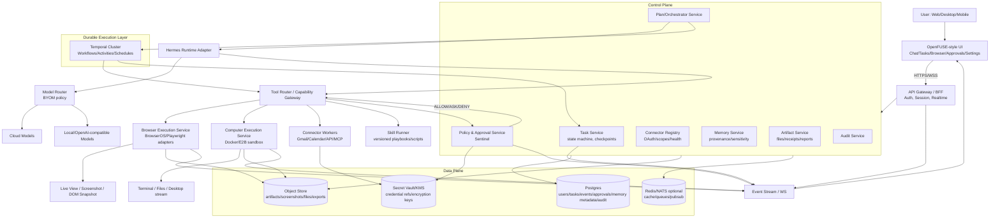
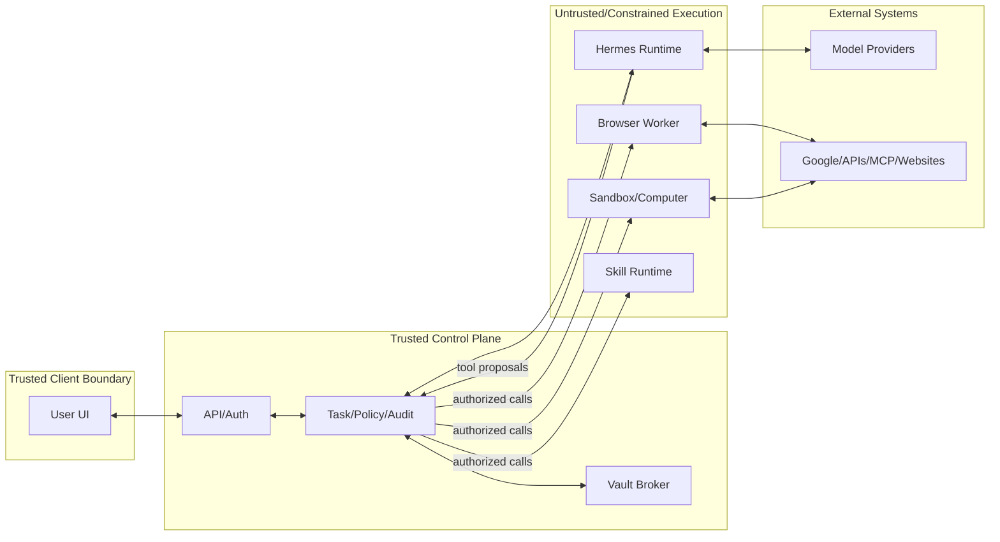
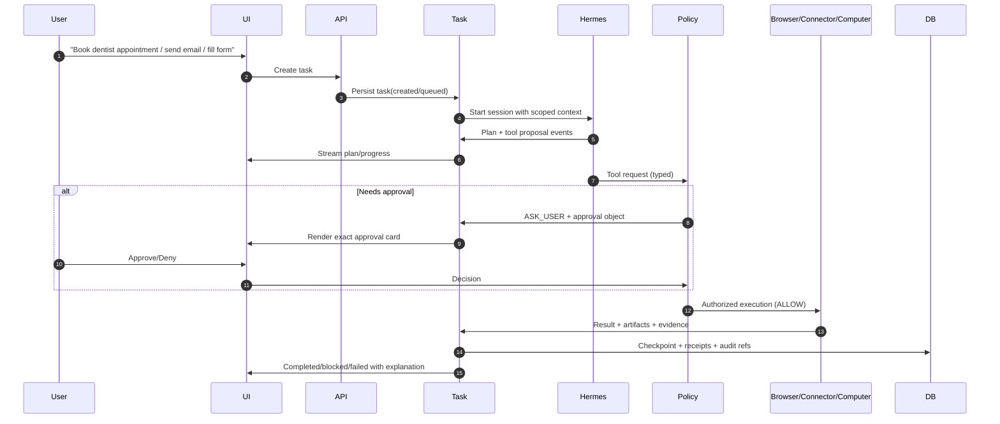

# 02 - System Architecture

## 1. Architecture Goals

- Separate **product UX**, **agent intelligence**, **execution**, **policy**, and **durable state**.
- Support **real task execution** with visible progress, approvals, takeover, and receipts.
- Make external effects **idempotent, auditable, and recoverable**.
- Allow swapping Hermes/model/browser/connector implementations without redesign.

## 2. High-Level Logical Architecture

## 3. Trust Boundaries

**Boundary rules:**
- Runtime never receives raw vault secrets.
- Runtime cannot approve itself; approvals are signed/persisted by policy service.
- Browser/computer workers execute only authorized, scoped commands.
- External web/content is untrusted input; never system instructions.

## 4. Component Responsibilities

| Component | Responsibilities | Must not do |
|---|---|---|
| UI (OpenFUSE-style) | Chat, task timeline, live workspace, approvals, settings | Direct secret access, direct privileged execution |
| API/BFF | AuthN/AuthZ, request validation, realtime fanout, rate limits | Business logic bypassing policy |
| Task Service | Task lifecycle, checkpoints, leases, retry metadata | Execute unapproved external writes |
| Hermes Adapter | Session lifecycle, prompt/tool orchestration, event normalization | Persist authoritative business state only in memory |
| Model Router | Provider selection, capability/sensitivity routing, fallback | Fallback to disallowed data region/provider |
| Policy/Sentinel | Risk classification, approval decisions, grant validation | Allow model-generated "approval" text |
| Browser Service | Session isolation, deterministic actions, screenshots, takeover | Unscoped arbitrary host control |
| Computer Service | Sandboxed command/file execution, artifacts | Host escape, credential exfiltration |
| Connector Workers | Typed API/MCP calls, token broker integration, retries | Raw token exposure to runtime |
| Temporal | Durable workflows, timers, schedules, retries, compensation | Replace product policy/audit source of truth |
| Audit/Telemetry | Immutable audit events, traces, metrics, redaction | Store secrets/PII in plaintext |

## 5. Execution Model: Hybrid "Agentic + Deterministic + Durable"

| Layer | Use when | Technology |
|---|---|---|
| Agentic planning | Ambiguous goals, multi-step reasoning, summarization | Hermes + model router |
| Deterministic execution | Known workflow/UI/API sequence | Playbooks, BrowserOS scripts, typed connector actions |
| Durable orchestration | Long-running, retry-prone, external side effects | Temporal workflows/activities |

**Rule:** LLM decides *what* and *when* among allowed capabilities; deterministic/durable layers decide *how reliably*.

## 6. Core Request Lifecycle

## 7. Deployment Architecture

### Dev (single machine)
- `apps/web`, `apps/api`, `apps/worker`, `apps/browser-worker`, optional `temporal-dev`.
- Postgres (or PGlite for local quickstart), local object store dir, local vault/mock vault.
- Docker for sandbox/browser isolation.

### Production (self-hosted/single tenant first)
- API/BFF behind reverse proxy (TLS).
- Control plane workers horizontally scalable.
- Temporal cluster (separate DB).
- Postgres HA, object store (S3-compatible), Redis/NATS.
- Vault/KMS (HashiCorp Vault, cloud KMS, or OS keychain for desktop-local mode).
- OTel collector + log/metrics/traces backend.

## 8. OpenFUSE Compatibility Mapping

| OpenFUSE concept | Blueprint implementation |
|---|---|
| Chat + task activity | UI `ChatPane`, `TaskTimeline`, AG-UI normalized events |
| Live browser workspace | Browser session service + embedded preview/takeover |
| Action proposals/approvals | `ActionProposal` + policy hash binding + receipts |
| Agent computer | Sandbox computer service (terminal/files/desktop) |
| Rich threads | CopilotKit/AG-UI compatible event model; thread persistence adapter |
| Task worker leases | DB compare-and-swap leases now; Temporal activities later |

## 9. NanoMuse-Inspired Patterns (Adopted Selectively)

- **Per-surface agent/session ownership:** no ambiguous control; explicit handoff.
- **Device/hub concept for future:** web/desktop/mobile as clients of same account/control plane.
- **Inspectability:** memory/permissions/approvals visible and editable.
- **"Ask before irreversible" default:** built into policy tiers.
- **Do not copy:** NanoMuse's specific app ecosystem/protocols unless needed; keep contracts generic.

## 10. Architectural Invariants

1. No external write without policy decision record.
2. No approval reuse on changed action hash.
3. No secret in model context unless explicitly redacted/transformed and policy-approved.
4. No task marked succeeded without evidence/receipt/check.
5. No silent retry for non-idempotent uncertain operations.
6. Every event carries `task_id`, `run_id`, `session_id` where applicable.
7. UI state is projection of persisted events/state, not hallucinated.

## 11. Key ADRs to Create During Implementation

- ADR-001: Hermes integration mode (embedded, sidecar, service).
- ADR-002: Temporal adoption scope (all tasks vs long-running only).
- ADR-003: Browser primary backend (BrowserOS vs Playwright first).
- ADR-004: Canonical event schema (AG-UI extension vs custom).
- ADR-005: Secret vault implementation (local desktop vs hosted).
- ADR-006: Memory store/index (Postgres FTS + pgvector vs external).
- ADR-007: Multi-device hub protocol (future).
- ADR-008: Skill packaging and signing.
