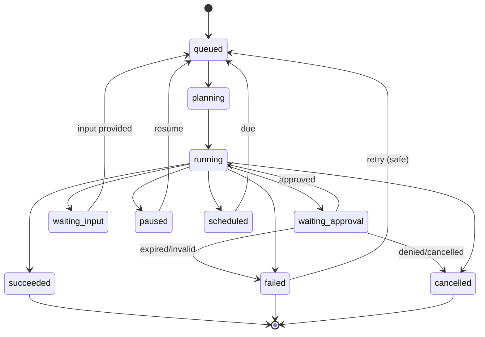

# 04 - Backend Control Plane

## 1. Role

The control plane is the trusted backend that owns users, tasks, policies, approvals, connectors, events, artifacts, and audit. It orchestrates Hermes, tool execution, and Temporal workflows while enforcing security boundaries.

## 2. Service Decomposition

Start as a **modular monolith** with clear internal boundaries; extract workers/services when scale or isolation requires.

| Module | Responsibility | Storage |
|---|---|---|
| Auth & Identity | Sessions, API keys, device auth, RBAC (single-user now) | Postgres |
| Task Service | Task CRUD, state machine, checkpoints, leases | Postgres |
| Event Service | Append-only events, WS fanout, replay cursors | Postgres + Redis pubsub |
| Orchestrator | Hermes run lifecycle, tool dispatch, run budgets | Postgres/Redis |
| Policy/Approval | Risk evaluation, approval requests, grants, receipts | Postgres + Vault |
| Connector Service | OAuth, scopes, health, connection metadata | Postgres + Vault |
| Artifact Service | Files, screenshots, reports, signed URLs | Object store + Postgres metadata |
| Memory Service | Memory records, provenance, retrieval index | Postgres + pgvector/FTS |
| Audit Service | Immutable audit log, export | Postgres append-only |

## 3. API Style

- **External API:** REST + WebSocket/SSE for events.
- **Internal service calls:** typed functions now; gRPC/HTTP later.
- **Schemas:** Zod/TypeBox/Pydantic equivalent; generate OpenAPI.
- **Versioning:** `/v1` prefix; event `schemaVersion`.

## 4. Core APIs (v1)

### 4.1 Tasks

```http
POST   /v1/tasks                      # create task
GET    /v1/tasks                      # list/filter
GET    /v1/tasks/:id                  # detail
POST   /v1/tasks/:id/control          # pause/resume/cancel/retry
POST   /v1/tasks/:id/input            # provide waiting_input
GET    /v1/tasks/:id/events           # replay events (cursor)
GET    /v1/tasks/:id/artifacts
```

### 4.2 Chat/Threads

```http
POST   /v1/threads
GET    /v1/threads/:id/messages
POST   /v1/threads/:id/messages       # user message -> may create/resume task
POST   /v1/threads/:id/stop
WS     /v1/events                     # realtime stream (auth scoped)
```

### 4.3 Approvals

```http
GET    /v1/approvals?status=pending
GET    /v1/approvals/:id
POST   /v1/approvals/:id/decision     # approve/deny
```

### 4.4 Connectors

```http
GET    /v1/connectors
POST   /v1/connectors/:provider/connect
POST   /v1/connectors/:provider/callback
POST   /v1/connectors/:id/disconnect
POST   /v1/connectors/:id/test
```

### 4.5 Browser/Computer

```http
POST   /v1/browser/sessions
POST   /v1/browser/sessions/:id/navigate
POST   /v1/browser/sessions/:id/input
POST   /v1/browser/sessions/:id/takeover
POST   /v1/browser/sessions/:id/release
GET    /v1/browser/sessions/:id/preview
POST   /v1/computer/commands
GET    /v1/computer/files
```

## 5. Task State Machine



**State rules:**
- Transitions validated server-side; illegal transitions return 409.
- Terminal states immutable except metadata (e.g., archive flag).
- `succeeded` requires completion criteria/evidence.
- `failed` includes error code, human message, retryability.

## 6. Task Execution Engine

### 6.1 Lease-Based Worker (MVP, OpenFUSE-proven)

Adopt the demo pattern:
- `compareAndSwap` claim: queued/scheduled-due/running-expired -> running with `leaseId`, `leaseUntil`, `attempts+1`.
- Heartbeat extends lease.
- Lost lease/abort throws `LostLeaseError`; worker requeues safely.
- `inFlight` prevents duplicate local execution.

### 6.2 Temporal Activities (V1+)

Map task steps to Temporal activities/workflows:
- Workflow ID = `task:{taskId}` or `goal:{goalId}`.
- Activity types: `plan`, `browser.act`, `connector.call`, `computer.run`, `memory.write`, `approval.wait`.
- Signals: pause/resume/cancel/input/approval.
- Queries: current status, checkpoint, last event.

## 7. Event System

### 7.1 Event Envelope

```json
{
  "eventId": "uuid",
  "schemaVersion": 1,
  "taskId": "task_123",
  "runId": "run_123",
  "sessionId": "sess_123",
  "sequence": 42,
  "ts": "2026-11-22T12:00:00Z",
  "source": "orchestrator|hermes|policy|browser|connector|temporal",
  "type": "tool.completed",
  "correlationId": "tool_call_abc",
  "causationId": "event_prev",
  "payload": {}
}
```

### 7.2 Delivery Semantics

- Append event to DB before acknowledging producer (for critical events).
- Publish to Redis/NATS for live WS fanout.
- Consumers idempotent by `eventId`.
- Client reconnect uses `GET /v1/tasks/:id/events?after=sequence`.

## 8. Orchestrator Responsibilities

1. Receive user goal/thread message.
2. Create/resume task and run context.
3. Load bounded context: goal, memory, recent messages, artifacts, connector state.
4. Call Hermes adapter.
5. For each tool proposal: validate schema -> policy check -> execute/ask.
6. Persist checkpoints after each significant step.
7. Emit normalized events.
8. Finalize with success/failure/blocked + evidence.

## 9. Connector and Action Execution

Adopt OpenFUSE `ActionService` pattern, generalized:

- `prepare(input, owner, connectionId)` resolves current target/version.
- Compute `actionHash` over kind, data, connection, targetVersion.
- Persist `awaiting_review` with expiry.
- `decide(approve/deny)`:
  - deny: mark denied, no side effect.
  - approve: CAS claim to `executing`; revalidate connection/hash/expiry/task status.
  - execute with idempotency key; store result/receipt.
  - uncertain provider outcome -> `outcome_unknown`, never blind retry.

## 10. Background Jobs

| Job | Trigger | Notes |
|---|---|---|
| Lease recovery | interval | Requeue expired running tasks |
| Approval expiry | interval/event | Expire stale approvals |
| Monitor scheduler | cron/Temporal schedule | Run page/API monitors |
| Notification digest | schedule | Batch non-urgent updates |
| Memory consolidation | async queue | Summarize/merge with provenance |
| Artifact cleanup | retention policy | Delete expired temp files |

## 11. AuthN/AuthZ

- **Single-user MVP:** strong local password/session or OS auth; API bearer for workers.
- **Desktop local mode:** bind API to loopback; random session token.
- **Hosted mode:** OIDC/OAuth login, CSRF protection, device sessions.
- **Authorization:** owner scoping on every DB query; worker tokens scoped to task/run.

## 12. Error Handling

Standard error envelope:

```json
{
  "error": {
    "code": "approval_invalid",
    "message": "This proposal changed. Open its latest review before deciding.",
    "retryable": false,
    "details": {}
  }
}
```

Rules:
- 4xx for validation/policy/user errors; 5xx for unexpected/system.
- Never expose secrets/internal stack traces to UI.
- Map provider errors to stable internal codes.

## 13. Backend Technology (Recommended)

| Concern | Default | Alternative |
|---|---|---|
| Runtime | Node.js 22+ TypeScript | Python for ML-heavy services |
| HTTP | Hono/Fastify | Express/NestJS |
| DB | Postgres 16 + Prisma/Drizzle/Kysely | SQLite local-only |
| Queue/pubsub | Redis Streams / NATS | BullMQ, Kafka later |
| Object store | S3-compatible (MinIO local) | local FS dev |
| Realtime | WS (ws/uWebSockets) | SSE |
| Validation | Zod | TypeBox/Valibot |
| Workflows | Temporal | DB-native scheduler for MVP |

## 14. Observability

- OpenTelemetry traces across API -> orchestrator -> tool -> provider.
- Structured JSON logs with `taskId`, `runId`, `eventId`, `owner`.
- Metrics: task success/failure, queue depth, lease recoveries, approval wait time, tool latency, duplicate-prevention hits.
- Redaction middleware before log/export.

## 15. Acceptance Criteria

- Task can be created, executed, paused, resumed, cancelled, and replayed after restart.
- Events are ordered per task and idempotent on consumer replay.
- Approval cannot execute stale/changed action.
- All DB queries owner-scoped.
- Uncertain external action never auto-retried blindly.
- API returns stable error codes and no secrets.
