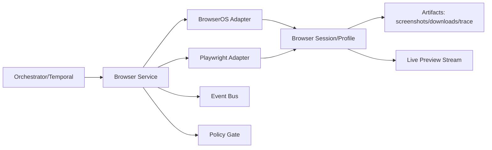

# 06 - Deterministic Browser and Computer Execution

## 1. Objective

Provide fast, reliable, visible execution for real web and computer tasks. Use **deterministic playbooks** for known flows, **agentic browser reasoning** for unknown flows, and **human takeover** whenever needed.

## 2. Execution Modes

| Mode | When to use | Engine | Reliability | Speed |
|---|---|---|---|---|
| API/Connector | Stable API exists | Connector worker | Highest | Highest |
| Deterministic browser playbook | Repeatable web flow | BrowserOS/Playwright script | High | High |
| Agentic browser | Unknown/variable UI | LLM + DOM/ARIA/screenshot tools | Medium | Medium |
| Computer use | Desktop app/file/terminal needed | Docker/E2B sandbox | Medium | Medium |
| Human takeover | Auth/CAPTCHA/ambiguous/sensitive step | User controls session | Highest for blocked step | N/A |

## 3. Browser Architecture



### 3.1 Browser Adapter Contract

```ts
interface BrowserExecutionProvider {
  capabilities(): Promise<BrowserCapabilities>;
  launch(input: LaunchInput): Promise<BrowserSession>;
  attach(sessionId: string): Promise<BrowserSession>;
  navigate(sessionId: string, url: string): Promise<ActionResult>;
  observe(sessionId: string): Promise<PageObservation>; // DOM/ARIA/text/screenshot
  act(sessionId: string, action: BrowserAction): Promise<ActionResult>;
  extract(sessionId: string, query: ExtractQuery): Promise<ExtractResult>;
  startTrace(sessionId: string): Promise<void>;
  stopTrace(sessionId: string): Promise<ArtifactRef>;
  pause(sessionId: string): Promise<void>;
  grantHumanControl(sessionId: string): Promise<ControlLease>;
  returnControl(leaseId: string): Promise<PageObservation>;
  close(sessionId: string): Promise<void>;
}
```

### 3.2 BrowserOS Role (User Requirement)

Use BrowserOS for its deterministic/browser-agent strengths where available:
- Native browser session control and extension-level capabilities.
- Deterministic scripted actions/playbooks.
- Better handling of real browser state/profile/cookies (with explicit user consent).
- Potential lower-latency local execution for UI interactions.

**Caution:** Verify actual BrowserOS/BrowserOS Neo APIs on Windows, live view, takeover, and session ownership before committing. Keep Playwright as production fallback.

### 3.3 Playwright Role

- Default reliable cross-platform backend.
- Persistent contexts/profiles per owner/session.
- Screenshot, DOM text extraction, download capture, tracing.
- Headed mode for takeover; headless for background jobs where safe.

## 4. Deterministic Playbook System

### 4.1 Playbook Format

```yaml
id: gmail-send-reply-v1
version: 1
risk: high
inputs:
  - name: threadId
  - name: replyText
preconditions:
  - connector.gmail.connected
  - approval.required
steps:
  - id: open
    action: browser.navigate
    url: "https://mail.google.com/mail/u/0/#inbox/{{threadId}}"
  - id: click_reply
    action: browser.click
    target: { role: button, name: "Reply" }
    timeoutMs: 10000
  - id: type
    action: browser.type
    target: { role: textbox, name: "Message Body" }
    value: "{{replyText}}"
  - id: submit
    action: browser.click
    target: { role: button, name: "Send" }
    requiresApproval: true
postconditions:
  - receipt.exists
```

### 4.2 Playbook Principles

- Prefer **ARIA roles/names**, stable data-testid, then CSS/XPath fallback.
- Every step has timeout, retry policy, and success assertion.
- Capture screenshot before/after high-risk steps.
- Parameterize inputs; never hardcode secrets.
- Version playbooks; test against fixture and live canary flows.
- Playbooks produce evidence and receipts, not just "done".

## 5. Browser Observation Strategy

Use layered observation for speed and robustness:

1. **Accessibility tree / DOM snapshot** - primary for deterministic actions.
2. **Visible text extraction** - for reading/summarization.
3. **Screenshot/vision** - fallback for canvas/complex UI.
4. **Network/console signals** - optional diagnostics, not authority.

Avoid sending full raw page HTML to model. Send compact structured observation:

```json
{
  "url": "...",
  "title": "...",
  "interactive": [{"role":"button","name":"Send","bbox":[...]}],
  "textExcerpt": "...",
  "alerts": ["modal open"],
  "screenshotRef": "obj://..."
}
```

## 6. Human Takeover

- User clicks **Take Over**: agent paused, control lease granted to user.
- UI shows prominent banner and disables agent actions.
- User actions occur in same session/profile.
- User clicks **Return Control**: agent receives fresh observation and resumes.
- All takeover intervals logged in audit trail.

## 7. Computer Execution (Sandbox)

### 7.1 Use Cases
- File transforms, PDF processing, scripts, local CLI tools.
- Workspace file management and artifact generation.
- Controlled desktop automation (v1+ selective).

### 7.2 Sandbox Contract

```ts
interface ComputerProvider {
  start(owner: string): Promise<ComputerState>;
  stop(owner: string): Promise<void>;
  runCommand(owner: string, cmd: string, opts: RunOpts): Promise<CommandResult>;
  listFiles(owner: string, path: string): Promise<FileEntry[]>;
  readFile(owner: string, path: string): Promise<FileContent>;
  writeFile(owner: string, path: string, content: string): Promise<void>;
  snapshot(owner: string): Promise<ArtifactRef>;
}
```

### 7.3 Isolation Rules
- No host mounts except controlled workspace volume.
- Non-root user, read-only root FS, dropped caps, seccomp/apparmor.
- Network disabled by default; browser handles web; explicit allowlist for package installs.
- CPU/memory/pid/time/output limits.
- Command allowlist/blocklist; shell metacharacter controls for high-risk mode.

## 8. BrowserOS vs Playwright Decision Matrix

| Capability | BrowserOS target | Playwright fallback | MVP default |
|---|---|---|---|
| Cross-platform stability | verify | strong | Playwright |
| Deterministic local speed | strong | good | BrowserOS where available |
| Live takeover UX | verify | good | Playwright |
| Profile/session persistence | verify | strong | Playwright |
| Trace/debug artifacts | verify | strong | Playwright |
| Extension/native browser APIs | strong | limited | BrowserOS |

## 9. Safety Controls

- URL allow/deny policies; block private network/metadata by default.
- Download type/size scanning; quarantine unknown executables.
- No autofill of secrets into unapproved domains.
- Sensitive actions (send/buy/delete/publish) require approval gate.
- Prompt injection defense: treat page text as data; strip/label instructions.

## 10. Evidence and Artifacts

For every significant browser/computer run store:
- action log, timestamps, session ID.
- screenshots before/after critical steps.
- DOM/text observation hashes.
- downloaded file metadata and storage refs.
- Playwright trace / BrowserOS trace where supported.
- final receipt or failure report.

## 11. Acceptance Criteria

- Same-session takeover and return control works without losing session.
- Deterministic playbook executes known flow with >= 95% success in test env.
- Agentic fallback handles minor UI drift.
- All downloads captured and attributable to task/session.
- No browser action executed against blocked/private destinations.
- Crash/restart recovers or reports partial completion clearly.
