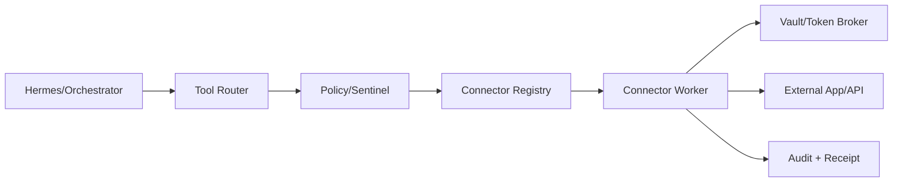

# 07 - Integrations: Apps, Models, and Connectors

## 1. Integration Strategy

Use the right integration type per surface:

| Type | Use when | Reliability | Security posture |
|---|---|---|---|
| Native API connector | Official API exists (Google, Slack, etc.) | High | Best - typed scopes/audit |
| MCP server | Tool ecosystem already MCP | Medium-High | Good if sandboxed/allowlisted |
| Browser automation | No API or UI-only flow | Medium | Requires strong policy |
| Desktop automation | Local app only | Medium-Low | Sandbox + approvals |

**Rule:** Prefer Native API > MCP > Browser > Desktop for side-effecting actions.

## 2. Connector Architecture



### 2.1 Connector Manifest

```yaml
name: gmail
version: 1
kind: native_api
auth: oauth2
scopes:
  - https://www.googleapis.com/auth/gmail.readonly
  - https://www.googleapis.com/auth/gmail.send
actions:
  - name: gmail.searchThreads
    risk: low
    idempotent: true
  - name: gmail.createDraft
    risk: medium
    idempotent: true
  - name: gmail.sendDraft
    risk: high
    idempotent: true
    requiresApproval: always
```

## 3. Connector Lifecycle

1. **Register** - manifest, schemas, risk, auth type.
2. **Connect** - OAuth/device auth/API key; store secret in vault, metadata in DB.
3. **Health check** - periodic token/scope/API test.
4. **Use** - policy-gated typed invocation.
5. **Rotate** - refresh tokens/keys.
6. **Disconnect/Revoke** - invalidate tokens, disable tools immediately, preserve audit.

## 4. MVP Connectors

| Connector | Actions | Risk | Approval |
|---|---|---|---|
| Gmail | search/read threads, create draft, send | send=high | send always |
| Google Calendar | list, create, update, delete event | write=medium/high | writes ask |
| Web browser | navigate/read/extract/fill/submit | varies | submit/send/pay ask |
| Filesystem (sandbox) | read/write/export | medium | writes outside workspace ask |
| Web search | query/fetch sources | low | no |

## 5. V1 Connectors

- Slack/Teams messaging (approval-gated send).
- Notion/Docs/Drive.
- GitHub issues/PR comments.
- WhatsApp/Telegram via official APIs or approved bridges.
- MCP server hub (user-added, sandboxed).

## 6. MCP Integration

### 6.1 MCP Policy

- Allowlist MCP servers; default deny unknown.
- Pin server version/command/image digest.
- Run local MCP servers in sandbox (no host network unless needed).
- Tool discovery cached; schema hash tracked.
- Per-tool risk classification overrides allowed only downward? No - policy can raise risk.

### 6.2 MCP Trust Levels

| Level | Description | Allowed |
|---|---|---|
| Trusted first-party | maintained by you/org | all policy-gated tools |
| Verified third-party | reviewed, pinned | read auto, writes ask |
| Unverified | user-added unknown | disabled by default |

## 7. Model Provider Integration (BYOM)

### 7.1 Provider Abstraction

Use OpenMuse-style provider-neutral contract:

```ts
interface ModelAdapter {
  capabilities(): ModelCapabilities;
  generate(req: NormalizedModelRequest): AsyncIterable<NormalizedModelEvent>;
  countTokens?(req): Promise<number>;
  health(): Promise<Health>;
}
```

### 7.2 Supported Provider Types

- OpenAI-compatible (OpenAI, Azure OpenAI, vLLM, Ollama, LM Studio, Groq, etc.)
- Anthropic-compatible
- Google/Gemini
- Local inference (Ollama/llama.cpp/vLLM)

### 7.3 Model Routing Policy

```yaml
routing:
  default: cloud.fast
  roles:
    planner: cloud.best
    browser_vision: cloud.vision
    summarizer: local.fast
    embeddings: local.embed
  sensitivity:
    public: any
    internal: approved_cloud_or_local
    restricted: local_only
  fallback:
    enabled: true
    require_same_sensitivity: true
    require_required_capabilities: true
```

### 7.4 Model Governance

- Per-provider data policy shown in UI.
- Token/cost budgets per task/day.
- Provider health checks and circuit breakers.
- Prompt/response logging redacted and configurable.

## 8. App Integration UX

- "Connect app" wizard: explain scopes, risk, example actions.
- Connection status badges: connected, degraded, expired, revoked.
- Test button runs low-risk health action.
- Disconnect immediately disables future actions and revokes tokens where supported.
- Show "Used by tasks" before disconnect.

## 9. Credential and Secret Handling

- OAuth tokens/API keys stored in vault only.
- DB stores `credentialRef`, scopes, expiry, account label.
- Workers receive short-lived scoped token or brokered request.
- Refresh tokens rotated; access tokens short TTL.
- Redact secrets from events, logs, traces, prompts.

## 10. Rate Limits, Retries, and Quotas

| Layer | Control |
|---|---|
| Connector | Per-provider rate limiter, backoff, jitter |
| Model | RPM/TPM/cost budget, concurrency limit |
| Browser | Domain/action pacing, max parallel sessions |
| User/task | Max active tasks, max tool calls, max runtime |

Retry rules:
- Retry idempotent reads/writes with idempotency key.
- Do not blindly retry uncertain external writes.
- On 429/5xx: exponential backoff with cap.

## 11. Integration Testing

- Contract tests per connector (mock provider).
- Sandbox/live smoke tests with test accounts.
- OAuth flow tests (connect/refresh/revoke).
- MCP server conformance and isolation tests.
- Model adapter conformance suite.
- Policy tests: scope escalation, disconnected connector, expired token.

## 12. Acceptance Criteria

- Adding a new connector requires manifest + adapter + tests, no core rewrite.
- Disconnected connector cannot be used by runtime.
- Model provider swap does not change task schema.
- MCP untrusted server cannot access vault or bypass policy.
- All external writes produce receipt/audit record.
