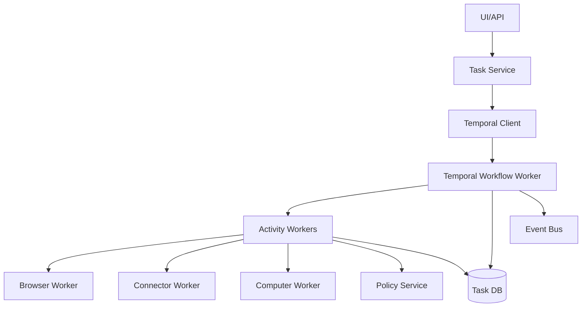

# 08 - Temporal-Like Reliable Execution

## 1. Goal

Make the assistant execute real tasks with **no silent failures**. Long-running work must be durable, observable, retry-safe, and recoverable after crashes, restarts, or provider outages.

> "No fail" in product terms means: **every action reaches a known terminal or waiting state with evidence; retries are bounded and safe; uncertain side effects are reconciled, not guessed.**

## 2. Reliability Model

| Property | Mechanism |
|---|---|
| Durability | Persist task/workflow state before ack; Temporal workflow history |
| At-least-once activity execution | Temporal activity retries / worker leases |
| Effectively-once external side effects | Idempotency keys + dedupe + receipt verification |
| Recoverability | Checkpoints, replay, resume signals |
| Visibility | Event log, timeline, receipts, alerts |
| Safety | Policy gates, approval signals, compensation/rollback where possible |

## 3. Why Temporal

OpenFUSE demo has DB lease worker (good MVP). Temporal adds:
- Durable timers/sleeps/schedules.
- Workflow replay after worker crash.
- Signals/queries for pause/resume/approval/cancel.
- Activity retry policies and timeouts.
- Native visibility and long-running workflow management.

## 4. Execution Topology



## 5. Workflow Design

### 5.1 Workflow Types

| Workflow | Trigger | Duration | Pattern |
|---|---|---|---|
| `TaskWorkflow` | user task | seconds-hours | plan -> execute steps -> finalize |
| `ApprovalWorkflow` | high-risk action | minutes-days | wait signal/timeout |
| `MonitorWorkflow` | schedule | days-months | periodic check, dedupe, notify |
| `RecoveryWorkflow` | failure/uncertain | variable | verify external state, reconcile |

### 5.2 TaskWorkflow Pseudocode

```ts
export async function taskWorkflow(input: TaskInput) {
  let state = await activities.initTask(input);
  state = await activities.plan(state);

  while (!state.done) {
    state = await waitForUnblockedState(state); // pause/cancel/approval/input signals

    const step = selectNextStep(state);
    const decision = await activities.evaluatePolicy(step);

    if (decision === "DENY") { state = markBlocked(state, step); continue; }
    if (decision === "ASK_USER") {
      await activities.requestApproval(step);
      const signal = await waitForApprovalSignal(step.id, timeout);
      if (!signal.approved) { state = markCancelledOrBlocked(state); continue; }
    }

    try {
      const result = await activities.executeStep(step, {
        idempotencyKey: step.idempotencyKey,
        timeout: step.timeout,
        retryPolicy: step.retryPolicy,
      });
      state = await activities.checkpointSuccess(state, step, result);
    } catch (err) {
      state = await activities.handleFailure(state, step, err);
    }
  }

  return await activities.finalizeTask(state);
}
```

## 6. Signals and Queries

### Signals
- `pause`, `resume`, `cancel`
- `provideInput(payload)`
- `approvalDecision({approvalId, approved, actor, reason})`
- `takeoverStarted`, `takeoverEnded`
- `externalEvent({type, data})`

### Queries
- `getStatus()`
- `getCurrentStep()`
- `getCheckpoint()`
- `getPendingApprovals()`

## 7. Idempotency and Deduplication

### 7.1 Idempotency Keys

Every external side effect gets deterministic key:

```text
idem:{tenant}:{taskId}:{stepId}:{action}:{targetHash}:{argsHash}
```

Store in `action_receipts` with unique constraint. Reuse result on replay/retry.

### 7.2 Action Receipt

```ts
type ActionReceipt = {
  id: string;
  taskId: string;
  stepId: string;
  idempotencyKey: string;
  actionType: string;
  target: string;
  requestHash: string;
  status: "executed" | "uncertain" | "failed";
  providerId?: string;
  responseMeta?: object;
  createdAt: string;
};
```

### 7.3 Uncertain Outcome Rule

If timeout/network error after possible write:
1. Mark `uncertain`.
2. Query provider for state using idempotency/provider ID.
3. If confirmed executed -> convert to receipt.
4. If confirmed not executed -> safe retry.
5. If still unknown -> escalate to user/manual reconciliation; do **not** blind retry.

## 8. Retry Policies

| Action class | Retry | Policy |
|---|---|---|
| Pure read | yes | exponential backoff, max 5 |
| Idempotent write with key | yes | limited, verify receipt |
| Non-idempotent write | no/guarded | verify-before-retry only |
| Browser click/type | yes | with state assertion |
| LLM generation | yes | backoff + fallback model |
| Approval wait | no retry | timeout/escalation |

Default activity options:
- `startToCloseTimeout`: per action type.
- `heartbeatTimeout`: long browser/computer actions.
- `retryPolicy`: non-retryable error types include `PolicyDenied`, `ValidationError`, `ApprovalRejected`.

## 9. Compensation / Rollback

Not all real-world actions roll back. Use compensations where possible:

| Action | Compensation |
|---|---|
| Create draft | delete draft |
| Create calendar event | delete event |
| Upload temp artifact | delete artifact |
| Send email / external submit | no true rollback; send correction/follow-up task |

Workflow must record compensability and execute compensations on cancellation/failure when safe.

## 10. Scheduling and Monitors

Temporal Schedules replace cron where possible:
- Monitor web page/API for changes.
- Daily/weekly summaries.
- Follow-up reminders.
- SLA/overdue task escalations.

Deduplication: hash observation + condition window to avoid noisy repeat notifications.

## 11. Human-in-the-Loop

- Approval requests are workflow signals, not chat text.
- Takeover pauses automation activities and extends heartbeat/timeout.
- User input resumes from checkpoint with fresh observation.
- Manual resolution can close `uncertain` receipts.

## 12. Failure Matrix

| Failure | Detection | Response |
|---|---|---|
| Worker crash | heartbeat/lease timeout | replay workflow/reschedule activity |
| Model provider 5xx | activity error | retry/fallback model |
| Browser crash | session health check | restart session, restore checkpoint |
| Connector rate limit | 429 | backoff, reschedule |
| Duplicate delivery | receipt/idempotency lookup | return prior result |
| Partial completion | checkpoint + missing steps | resume or compensate |
| Unknown external write | timeout/ambiguous response | reconciliation workflow |

## 13. Operational Controls

- Concurrency limits per owner/task/provider.
- Max workflow duration and max steps.
- Dead-letter/manual review queue for irreconcilable actions.
- Kill switch: disable all external writes.
- Replay testing in staging before workflow version rollout.

## 14. MVP to V1 Migration

**MVP:** DB lease worker + checkpoints + idempotency + receipts (OpenFUSE pattern).  
**V1:** Introduce Temporal for long-running/scheduled/high-risk workflows first; keep simple tasks on DB worker if desired.  
**V2:** All durable tasks on Temporal; DB worker only for lightweight ephemeral jobs.

## 15. Acceptance Criteria

- Kill worker mid-task; task resumes or fails clearly with no duplicate side effect.
- Duplicate signal/event delivery does not duplicate action.
- Approval timeout transitions to explicit state.
- Uncertain send/write is reconciled before retry.
- Monitor workflow runs across restart and dedupes observations.
- 100% external writes have idempotency key and receipt record.
