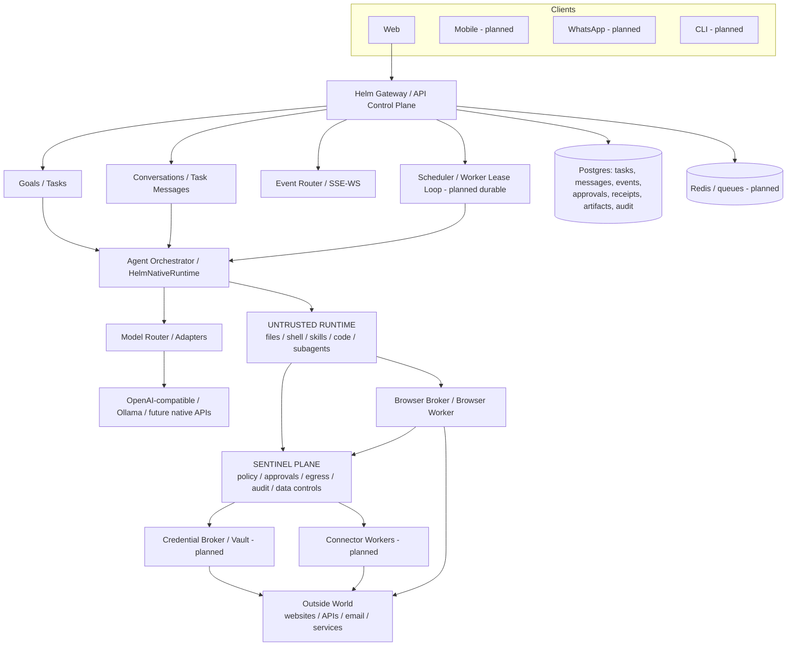

# Helm

Helm is an original personal AI operating assistant built from scratch for the Dubai competition. It implements similar/better capabilities with Helm-owned code and replaceable contracts; no third-party proprietary/AGPL source is copied into this repository.

- Source blueprint: `../Personal_assistant/Planning/MASTER-TECHNICAL-BLUEPRINT.md`
- Session handoff: `changes/README.md` and `changes/CURRENT_STATE.md`
- Agent rules: `AGENTS.md`

## Current state (2026-11-23)
Phase 0 is dev-complete; Phase 1 chat-first task UI is live (API + worker + web + SSE/WS). Phase 2 model runtime has streaming + basic tool-calling loop; Phase 3 browser worker has guarded actions, preview, and session restore baseline. See `changes/CURRENT_STATE.md`.

## Architecture

**Flow:** client prompt -> gateway stores task/message -> orchestrator leases task -> model adapter streams response/tool calls -> untrusted runtime proposes actions -> sentinel plane enforces approval/hash/idempotency/audit -> browser/connector brokers execute allowed actions -> receipts/artifacts/events/messages persist -> clients render chat, timeline, approvals, evidence, live preview.

## License and Third-Party Dependencies

- Helm project license: see LICENSE.
- Third-party dependency licenses: see THIRD_PARTY_NOTICES.md.
- AGPL/copyleft code (e.g., BrowserOS) is not vendored into Helm. Optional external adapters require separate compliance review.

