# Helm

Helm is an original personal AI operating assistant built from scratch for the Dubai competition. It implements similar/better capabilities with Helm-owned code and replaceable contracts; no third-party proprietary/AGPL source is copied into this repository.

- Source blueprint: `../Personal_assistant/Planning/MASTER-TECHNICAL-BLUEPRINT.md`
- Session handoff: `changes/README.md` and `changes/CURRENT_STATE.md`
- Agent rules: `AGENTS.md`

## Progress

**[Explore the full visual roadmap →](ROADMAP.md)**

| Scope | Progress | Notes |
|---|---:|---|
| **Overall** | **~90%** | Usable prototype baseline; P5 proofs strong, P6 adapter dispatch wired behind flag, P7 flagged identity/memory DB slices, P8 evidence/checklists added |
| Phase 0 Foundation | 91% | Contracts/dev/bootstrap + workspace typecheck/DX config stable |
| Phase 1 UI/Task Core | 91% | Chat/SSE/approvals/preview usable; lifecycle/idempotency/SSE regressions added |
| Phase 2 Agent Runtime | 56% | Local Ollama streaming + basic tool-calling; guardrails present, richer policy pending |
| Phase 3 Browser Execution | 93% | Ownership integration coverage, takeover, stale-session restart recovery, WS bearer auth |
| Phase 4 Approvals/Vault/Connectors | 88% | Vault/connector contracts, Gmail read/send, Calendar read/create/update/delete approval-gated with uncertain reconcile; real OAuth E2E blocked on external creds |
| Phase 5 Temporal Reliability | 50% | Feature-flagged routing for Gmail/Calendar/browser external actions; stub/real-dedupe/mock-side-effect/rollback E2E proofs; runbook added |
| Phase 6 BrowserOS Upgrade | 25% | Adapter interface + Playwright default + BrowserOS stub; adapter status/request/requestBinary dispatch + adapter-aware session lookup behind HELM_BROWSER_ADAPTER_DISPATCH; real BrowserOS endpoint/parity pending |
| Phase 7 Memory/Skills/Proactivity | 35% | Identity contracts/status/create/policy read (helm-owned default), restrictive default policy, identities/identity_policies/memory_notes/skills/proactivity_rules schema, DB-backed notes/skills/proactivity rules behind flags with PATCH; self-improvement gated/design-only (no activation) |
| Phase 8 Hardening/Release | 20% | Backup/restore scripts+runbooks, security/privacy/release-evidence checklists added; drills, scans/threat model, PII lifecycle, compliance signoff pending |

> Detailed journey, milestones, and past/present/future plan: **[ROADMAP.md](ROADMAP.md)** · Operational evidence: **[changes/CURRENT_STATE.md](changes/CURRENT_STATE.md)**

### CI / Build Status

- **GitHub Actions CI is green on `main`** when lint, typecheck, test, and build pass. The badge above reflects the latest `main` workflow result.
- **Why the green line may look “constant”:** CI runs on every push/PR and reports pass/fail for that commit; it does not measure product completion. During active build phases, many commits may pass CI while feature completeness is still partial. A flat green contribution/check line means checks are passing consistently, not that the project is 100% complete.
- **Service-dependent integration tests** (Postgres/API/browser live) are gated behind explicit env vars (`HELM_INTEGRATION=1`, `HELM_INTEGRATION_API=1`) so default CI stays deterministic; they are run intentionally in environments where those services are provisioned.

## Architecture

```mermaid
flowchart TB
  subgraph Clients["Clients"]
    WEB[Web]
    MOBILE[Mobile - planned]
    WA[WhatsApp - planned]
    CLI[CLI - planned]
  end

  WEB --> GW[Helm Gateway / API Control Plane]

  GW --> CONV[Conversations / Task Messages]
  GW --> GOALS[Goals / Tasks]
  GW --> ROUTER[Event Router / SSE-WS]
  GW --> SCHED[Scheduler / Worker Lease Loop - planned durable]

  GOALS --> ORCH[Agent Orchestrator / HelmNativeRuntime]
  CONV --> ORCH
  SCHED --> ORCH

  ORCH --> MR[Model Router / Adapters]
  MR --> MODELS[OpenAI-compatible / Ollama / future native APIs]

  ORCH --> UR[UNTRUSTED RUNTIME\nfiles / shell / skills / code / subagents]
  UR --> BB[Browser Broker / Browser Worker]

  UR --> SP[SENTINEL PLANE\npolicy / approvals / egress / audit / data controls]
  BB --> SP

  SP --> CB[Credential Broker / Vault - planned]
  SP --> CW[Connector Workers - planned]

  CB --> OUT[Outside World\nwebsites / APIs / email / services]
  CW --> OUT
  BB --> OUT

  GW --> DB[(Postgres: tasks, messages, events,\napprovals, receipts, artifacts, audit)]
  GW --> REDIS[(Redis / queues - planned)]
```

**Flow:** client prompt -> gateway stores task/message -> orchestrator leases task -> model adapter streams response/tool calls -> untrusted runtime proposes actions -> sentinel plane enforces approval/hash/idempotency/audit -> browser/connector brokers execute allowed actions -> receipts/artifacts/events/messages persist -> clients render chat, timeline, approvals, evidence, live preview.

## License and Third-Party Dependencies

- Helm project license: see LICENSE.
- Third-party dependency licenses: see THIRD_PARTY_NOTICES.md.
- AGPL/copyleft code (e.g., BrowserOS) is not vendored into Helm. Optional external adapters require separate compliance review.

