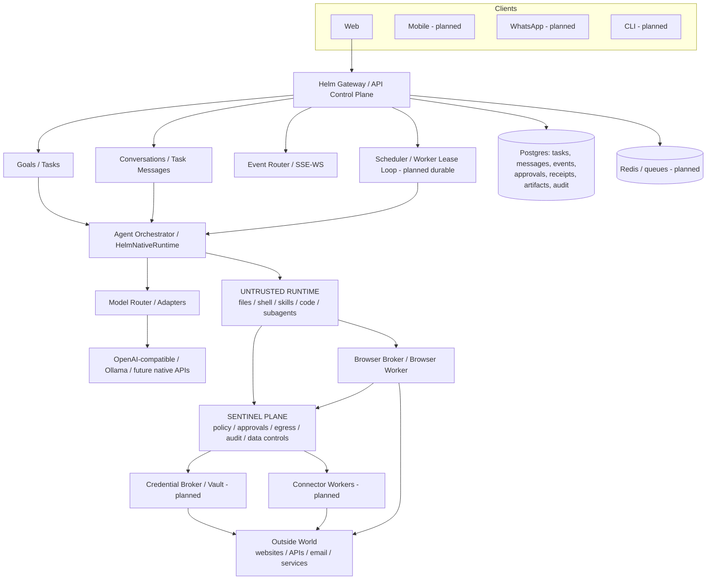

# Helm

Helm is an original personal AI operating assistant built from scratch for the Dubai competition. It implements similar/better capabilities with Helm-owned code and replaceable contracts; no third-party proprietary/AGPL source is copied into this repository.

- Source blueprint: `../Personal_assistant/Planning/MASTER-TECHNICAL-BLUEPRINT.md`
- Session handoff: `changes/README.md` and `changes/CURRENT_STATE.md`
- Agent rules: `AGENTS.md`

## Progress

**[Explore the full visual roadmap →](ROADMAP.md)**

| Scope | Progress | Notes |
|---|---:|---|
| **Overall** | **72.2%** | CI green, local lint/typecheck/build/test green; P4 real OAuth write E2E verified; P6 BrowserOS MCP adapter + env-gated smoke landed; real-provider/Temporal depth, live UI smoke, ops/legal signoff remain |
| Phase 0 Foundation | 93% | Monorepo/CI/Docker/contracts stable; Drizzle alignment script cwd-independent/idempotent; fresh-clone CI confirmation and tsconfig dist/src cleanup remain |
| Phase 1 UI/Task Core | 91% | Chat/SSE/approvals/preview/takeover usable; SSE cursor-resume/fault-injection E2E depth and live UI smoke pending |
| Phase 2 Agent Runtime | 73% | Local Ollama streaming, tool policy/approval gating, model override/config validation; live real browser+connector E2E and eval evidence pending |
| Phase 3 Browser Execution | 93% | Playwright worker, CDP screencast, WS proxy, persist/restore, guarded actions; live WS/takeover smoke pending |
| Phase 4 Approvals/Vault/Connectors | 90% | Vault/OAuth PKCE, Gmail/Calendar read+write approval-gated; real Gmail send + Calendar create E2E idempotent/no-duplicate verified; refresh/revoke/uncertain hardening pending |
| Phase 5 Temporal Reliability | 68% | Routing/fail-closed, DB-canonical reconciliation/scheduler, env-gated reconciliation e2e PASS; real-provider no-duplicate and deeper Temporal/operator proof pending |
| Phase 6 BrowserOS Upgrade | 52% | Playwright default; BrowserOS MCP adapter (`BROWSEROS_MCP_URL`) behind contract, capability/timeout/error hardening, 11/11 contract tests, env-gated smoke PASS; full parity/security/fallback policy pending |
| Phase 7 Memory/Skills/Proactivity | 48% | Identity/policy enforcement, P7 tables, memory/skills/proactivity flags; identity vault/UI, scheduler, provenance/CRUD/export pending; self-improvement activation needs explicit approval |
| Phase 8 Hardening/Release | 43% | Backup scripts+dry-run, redaction/checklists, task export/delete, dep audit baseline; backup/restore drill, scan gating, threat model, PII/legal, Dubai signoff pending |

> Detailed journey, milestones, and past/present/future plan: **[ROADMAP.md](ROADMAP.md)** · Operational evidence: **[changes/CURRENT_STATE.md](changes/CURRENT_STATE.md)**

### CI / Build Status

- **GitHub Actions CI is green on `main`** when lint, typecheck, test, and build pass. The badge above reflects the latest `main` workflow result.
- **Why the green line may look “constant”:** CI runs on every push/PR and reports pass/fail for that commit; it does not measure product completion. During active build phases, many commits may pass CI while feature completeness is still partial. A flat green contribution/check line means checks are passing consistently, not that the project is 100% complete.
- **Service-dependent integration tests** (Postgres/API/browser live) are gated behind explicit env vars (`HELM_INTEGRATION=1`, `HELM_INTEGRATION_API=1`) so default CI stays deterministic; they are run intentionally in environments where those services are provisioned.

## Architecture

**Flow:** client prompt -> gateway stores task/message -> orchestrator leases task -> model adapter streams response/tool calls -> untrusted runtime proposes actions -> sentinel plane enforces approval/hash/idempotency/audit -> browser/connector brokers execute allowed actions -> receipts/artifacts/events/messages persist -> clients render chat, timeline, approvals, evidence, live preview.

## License and Third-Party Dependencies

- Helm project license: see LICENSE.
- Third-party dependency licenses: see THIRD_PARTY_NOTICES.md.
- AGPL/copyleft code (e.g., BrowserOS) is not vendored into Helm. Optional external adapters require separate compliance review.

