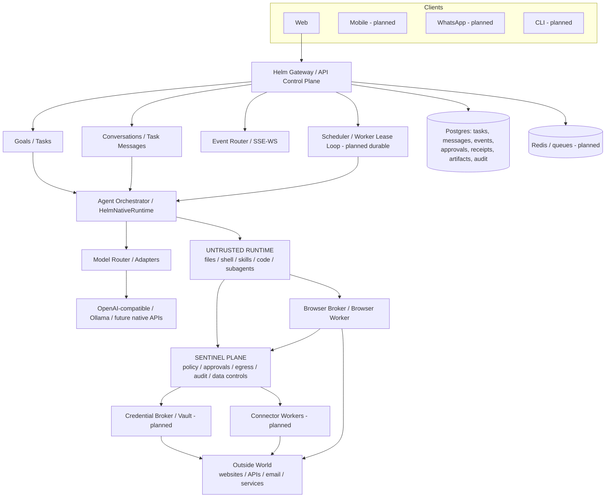

# Helm

Helm is an original personal AI operating assistant built from scratch for the Dubai competition. It implements similar/better capabilities with Helm-owned code and replaceable contracts; no third-party proprietary/AGPL source is copied into this repository.

- Source blueprint: `../Personal_assistant/Planning/MASTER-TECHNICAL-BLUEPRINT.md`
- Session handoff: `changes/README.md` and `changes/CURRENT_STATE.md`
- Agent rules: `AGENTS.md`

## Progress

**[Explore the full visual roadmap →](ROADMAP.md)**

| Scope | Progress | Notes |
|---|---:|---|
| **Overall** | **~68%** | Prototype baseline; binding-audit hardening + regression tests added |
| Phase 0 Foundation | 90% | Contracts/dev/bootstrap mostly stable |
| Phase 1 UI/Task Core | 87% | Chat/SSE/approvals/preview usable |
| Phase 2 Agent Runtime | 53% | Streaming + basic tool-calling; hardening pending |
| Phase 3 Browser Execution | 78% | Ownership/authz + guarded actions; recovery hardening pending |
| Phase 4 Approvals/Vault/Connectors | 52% | Resolve invariants/tests added; vault/connectors pending |
| Phase 5 Temporal Reliability | 5% | Primitives only |
| Phase 6 BrowserOS Upgrade | 0% | Planned |
| Phase 7 Memory/Skills/Proactivity | 0% | Design/proposed only |
| Phase 8 Hardening/Release | 5% | Early evidence only |

> Detailed journey, milestones, and past/present/future plan: **[ROADMAP.md](ROADMAP.md)** · Operational evidence: **[changes/CURRENT_STATE.md](changes/CURRENT_STATE.md)**

## Architecture

**Flow:** client prompt -> gateway stores task/message -> orchestrator leases task -> model adapter streams response/tool calls -> untrusted runtime proposes actions -> sentinel plane enforces approval/hash/idempotency/audit -> browser/connector brokers execute allowed actions -> receipts/artifacts/events/messages persist -> clients render chat, timeline, approvals, evidence, live preview.

## License and Third-Party Dependencies

- Helm project license: see LICENSE.
- Third-party dependency licenses: see THIRD_PARTY_NOTICES.md.
- AGPL/copyleft code (e.g., BrowserOS) is not vendored into Helm. Optional external adapters require separate compliance review.

