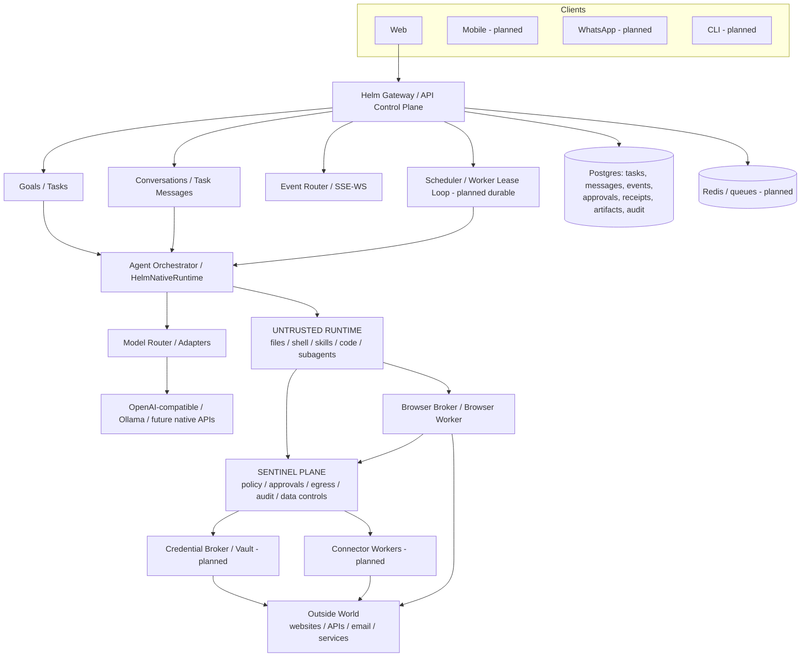

# Helm

Helm is an original personal AI operating assistant built from scratch for the Dubai competition. It implements similar/better capabilities with Helm-owned code and replaceable contracts; no third-party proprietary/AGPL source is copied into this repository.

- Source blueprint: `../Personal_assistant/Planning/MASTER-TECHNICAL-BLUEPRINT.md`
- Session handoff: `changes/README.md` and `changes/CURRENT_STATE.md`
- Agent rules: `AGENTS.md`

## Progress

**[Explore the full visual roadmap →](ROADMAP.md)**

| Scope | Progress | Notes |
|---|---:|---|
| **Overall** | **83.2%** | Equal-weight P0-P8. Last watched CI green: [45715144160](https://github.com/Tapas15/helm/actions/runs/45715144160) (`4a9b458`); local commits after it not CI-watched per directive. P5 gained deterministic Temporal/reconciliation contract hardening (routing fail-closed, rollback, no-blind-retry, stub dedupe/schedule, operator evidence semantics) but real Temporal/provider sandbox closure remains blocked. |
| Phase 0 Foundation | 94% | Monorepo/CI/Docker/contracts stable; Drizzle alignment script cwd-independent/idempotent; local gates PASS; fresh-clone CI confirmation after push remains |
| Phase 1 UI/Task Core | 92% | Chat/SSE/approvals/preview/takeover usable; SSE `Last-Event-ID` resume fallback + cursor validation covered; live UI smoke/fault-injection depth pending |
| Phase 2 Agent Runtime | 90% | Local Ollama streaming/tool loop/policy; checkpoint/resumePlan narrowed semantics, approval/read-tool dedupe guards, deterministic evals. Remaining: full durable step-level replay, live browser+connector/model-provider E2E, live Hermes sidecar. |
| Phase 3 Browser Execution | 93% | Playwright worker, CDP screencast, WS proxy, persist/restore, guarded actions; screenshot/snapshot artifact DB persistence + ownership-checked artifact listing + takeover request/resume state contracts; live WS/takeover smoke blocked in shell |
| Phase 4 Connectors/Vault | 90% | Vault AES-GCM, Gmail/Calendar read+write, guarded receipts/reconcile UI; real OAuth connect/test/send/create E2E verified; refresh/revoke/uncertain-reconcile hardening pending |
| Phase 5 Temporal/Reliability | 80% | ADR-002, routing/fail-closed, DB-canonical reconciliation/scheduler/dry-run; deterministic contract hardening for routing rollback, no-blind-retry/repeated-run, fault-injection, stub dedupe/schedule, run-shape/scope/disabled/operator-evidence semantics. Remaining: real-provider no-duplicate proof, real Temporal schedule/monitor/fault-injection depth, production/staging rollback proof. |
| Phase 6 BrowserOS Upgrade | 66% | Playwright default; external BrowserOS MCP adapter behind contract; dispatch OFF. Env-gated MCP smoke/parity evidence exists; deeper parity, formal STRIDE/threat-model/PII retention evidence, and dispatch gate pending |
| Phase 7 Memory/Skills/Proactivity | 97% | P7a feedback/eval/proposal scaffold + redacted flag-gated emissions; P7b memory CRUD/export/audit/retrieval/consolidation+retention dry-runs, fail-closed embedding seam, contract hardening. Blocked: retention enforcement/delete, consolidation apply/merge, external embedding runtime wiring default off, worker-claim/browser-worker DB feedback contract decisions, P7c/P7d activation/apply/auto-run (explicit written approval required) |
| Phase 8 Hardening/Release | 45% | Backup scripts hardened (SHA256/checksum/force guard), backup dry-run, redaction/checklists, task export/delete, dep audit baseline; backup/restore drill, scan gating, threat model, PII/legal, Dubai signoff pending |

> Detailed journey: **[ROADMAP.md](ROADMAP.md)** · Operational evidence: **[changes/CURRENT_STATE.md](changes/CURRENT_STATE.md)** · P7b contract: **[changes/p7b-memory-status-contract.md](changes/p7b-memory-status-contract.md)**

### CI / Build Status

- **GitHub Actions CI is green on `main`** when lint, typecheck, test, and build pass. The badge above reflects the latest `main` workflow result.
- **Why the green line may look "constant":** CI runs on every push/PR and reports pass/fail for that commit; it does not measure product completion. During active build phases, many commits may pass CI while feature completeness is still partial. A flat green contribution/check line means checks are passing consistently, not that the project is 100% complete.
- **Service-dependent integration tests** (Postgres/API/browser live) are gated behind explicit env vars (`HELM_INTEGRATION=1`, `HELM_INTEGRATION_API=1`) so default CI stays deterministic; they are run intentionally in environments where those services are provisioned.

## Architecture

**Flow:** client prompt -> gateway stores task/message -> orchestrator leases task -> model adapter streams response/tool calls -> untrusted runtime proposes actions -> sentinel plane enforces approval/hash/idempotency/audit -> browser/connector brokers execute allowed actions -> receipts/artifacts/events/messages persist -> clients render chat, timeline, approvals, evidence, live preview.

## License and Third-Party Dependencies

- Helm project license: see LICENSE.
- Third-party dependency licenses: see THIRD_PARTY_NOTICES.md.
- AGPL/copyleft code (e.g., BrowserOS) is not vendored into Helm. Optional external adapters require separate compliance review.

