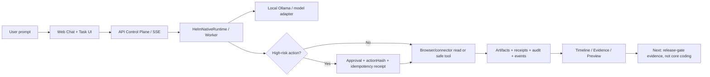
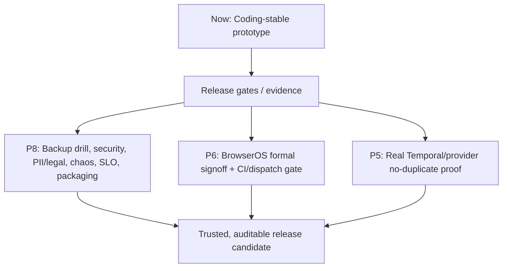

<div align="center">

# Helm Roadmap

**The journey of building a personal AI operating assistant � from blueprint to trusted execution.**

[-1f6feb?style=for-the-badge)](changes/CURRENT_STATE.md)
[](changes/CURRENT_STATE.md)
[](#-present--what-were-building-now)

<br/>

[README](README.md) � [Current State](changes/CURRENT_STATE.md) � [Missing Items](changes/PLANNING_MISSING_ITEMS.md) � [Gap Analysis](changes/BLUEPRINT_GAP_ANALYSIS_2026-11-23.md) � [Binding Audit](changes/BINDING_AUDIT_2026-11-23.md)

</div>

---

> [!NOTE]
> Percentages are **engineering-progress estimates** from current evidence (code, tests, smokes, docs). They are **not** release, security, or compliance completion.

## Compass

| | |
|---|---|
| **Mission** | Build Helm as an original personal AI operating assistant: OpenFUSE-style control surface + Helm-native runtime + deterministic browser execution + reliability/security. |
| **Invariants** | Model proposes, policy decides � UI is not intelligence � Durable state � Idempotent external effects + receipts � No secrets in logs/events/prompts |
| **Source of truth** | [`changes/CURRENT_STATE.md`](changes/CURRENT_STATE.md) is authoritative for status; this roadmap is the visual journey. |

---

## Journey At A Glance


---

## Progress Dashboard

<table>
<tr>
<td width="50%" valign="top">

### Overall

**`87.8%`** coding-only (P0-P8 equal weight, not release-readiness)

```text
[██████████████████░░] 87.8%
```

**Usable prototype with active hardening.** P1 coding-scope is closed (6/6 E2E + 2/2 lease/fault-depth integration). P5 real Temporal/provider sandbox closure, P6 parity/security, and P8 ops/legal signoff remain.

</td>
<td width="50%" valign="top">

### Current Wave

**P0 complete; P6 BrowserOS parity/security gate + P5 real-env closure next**

- P0 foundation gate closed: CI fresh-DB migrate smoke green, tooling/artifact hygiene done
- Keep Playwright default; BrowserOS external MCP adapter explicit opt-in
- Expand env-gated parity evidence (artifact/error/takeover semantics)
- Harden endpoint/config validation and remote-endpoint guard
- No silent fallback/default dispatch; dispatch gate requires parity+security+CI evidence

</td>
</tr>
</table>

| Phase | Progress | Journey | Bar |
|---|---:|:---:|---|
| **P0 Foundation / Repo** | 100% | Complete | `████████████████████` 100% |
| **P1 UI / Task Core** | 100% | Complete (coding scope) | `████████████████████` 100% |
| **P2 Agent Runtime** | 90% | Present | `██████████████████░░` 90% |
| **P3 Browser Execution** | 93% | Present | `███████████████████░` 93% |
| **P4 Approvals / Vault / Connectors** | 90% | Present | `██████████████████░░` 90% |
| **P5 Temporal / Reliability** | 80% | Present | `████████████████░░░░` 80% |
| **P6 BrowserOS Deterministic Upgrade** | 66% | Present / gate pending | `█████████████░░░░░░░` 66% |
| **P7 Memory / Skills / Proactivity** | 97% | Present | `███████████████████░` 97% |
| **P8 Hardening / Release** | 74% | Coding-stable; release gates pending | `███████████████░░░░░` 74% |

---

## Past � What Has Been Built

> The groundwork: contracts, durable task state, visible UI, and the first safe execution loop.

<table>
<tr>
<td width="33%" valign="top">

### ? P0 � Foundation
**100%**

- pnpm/turbo/TS monorepo
- Docker Postgres/Redis
- Shared Zod contracts + Drizzle schema
- CWD-independent Drizzle align script
- CI green with Postgres + fresh-DB migrate smoke

</td>
<td width="33%" valign="top">

### ?? P1 � UI / Task Core
**91%**

- Chat-first task UI
- Live SSE timeline
- Approvals / evidence / receipts
- WS browser preview + polling fallback
- Follow-up messages on same task

</td>
<td width="33%" valign="top">

### ?? Evidence Trail
**Active**

- `changes/CURRENT_STATE.md`
- `changes/SESSION_LOG.md`
- `changes/BLUEPRINT_GAP_ANALYSIS_2026-11-23.md`
- `changes/BINDING_AUDIT_2026-11-23.md`
- `changes/FIX_LOG.md`

</td>
</tr>
</table>

### Milestones Achieved

- [x] Repo/contracts/dev baseline established
- [x] Task create/control/SSE/event flow working
- [x] Chat-first UI with streaming and follow-up
- [x] Browser preview + takeover controls
- [x] Approval + `actionHash` + idempotency guard baseline
- [x] Session metadata/storageState restore baseline
- [x] Local Ollama simple E2E task smoke passed

---

## Present � What We're Building Now

> Current state: Helm is a working prototype with real task/runtime/browser/approval flows. P8 coding hardening is stable; release confidence is blocked by manual ops/security/legal evidence.



<table>
<tr>
<td width="33%" valign="top">

### ?? P2 � Agent Runtime
**90% � Present**

**Delivered**
- HelmNativeRuntime + normalized `runtime.*` events
- OpenAI-compatible streaming; local Ollama defaults
- Tool loop/policy/registry, unknown tool blocked
- High-risk approval gate + `actionHash`/idempotency
- Checkpoint/resumePlan narrowed semantics, read/side-effect dedupe guards
- Deterministic runtime evals; fail-closed Hermes adapter skeleton (no Hermes code copied)

**Remaining (mostly non-coding proof)**
- Real browser+connector+model-provider E2E validation
- Live Hermes sidecar integration proof (optional, external)
- Full durable step-level replay semantics

</td>
<td width="33%" valign="top">

### ?? P3 � Browser Execution
**93% � Present**

**Delivered**
- Playwright browser worker + CDP screencast/WS proxy
- Screenshot/snapshot artifacts persisted with ownership checks
- Takeover request/resume state contracts, audit/events
- Guarded external actions with approval/hash/idempotency
- Crash/recovery and ownership hardening

**Remaining (mostly env/manual proof)**
- Live interactive WS/takeover smoke (click/type/scroll/drag/modifiers)
- Browser crash/reconnect/restart depth in real env
- Artifact retention/download/network evidence policy

</td>
<td width="33%" valign="top">

### ??? P4 � Approvals / Safety / Connectors
**90% � Present**

**Delivered**
- Approval resolve/requeue/cancel + action receipts
- Local AES-GCM vault; secrets not returned by API
- Google OAuth PKCE scaffold, refresh/revoke hardening baseline
- Gmail/Calendar read+write guarded; real OAuth connect/send/create E2E verified
- Identity policy enforcement (flag-aware) on key side-effect paths

**Remaining (mostly external/manual)**
- Real-provider uncertain/timeout reconcile sandbox proof
- Token refresh/revoke hardening against real provider behavior
- Production vault/KMS decision and connector diagnostics/policy audit

</td>
</tr>
</table>

### Active Priorities

| Priority | Why it matters | Exit signal |
|---|---|---|
| **P8 release-gate evidence** | Coding is stable; release confidence is not | Backup/restore drill (artifacts+vault-key), scan gating/SAST/secrets/container decisions, STRIDE/threat-model + incident/key-rotation signoff, PII/privacy/classification signoff, compliance/Dubai/provenance signoff, chaos/fault matrix, SLO/alerts, packaging/release gates |
| **P6 BrowserOS security/parity gate** | External adapter must stay safe and equivalent before default dispatch | Formal security signoff, real-browser takeover/artifact/error parity evidence, CI gate, dispatch remains off by default |
| **P5 real Temporal/provider proof** | Deterministic contracts exist; real infra proof still missing | Real Temporal schedule/monitor/fault-injection depth, real-provider no-duplicate proof, staging/rollback evidence |
| **P1-P3 live E2E smoke** | Confirms user-visible flows beyond deterministic tests | Browser-level SSE reconnect, live WS/takeover smoke, full create/approve/reject/retry/pause/resume/cancel/preview evidence |

---

## Future � What We Will Achieve

> Destination: release-grade, inspectable personal AI operator. Most remaining work is evidence/gates, not core feature coding.



<table>
<tr>
<td width="50%" valign="top">

### ?? P5 Real-Environment Proof
- Real Temporal schedule/monitor/fault-injection depth
- Real-provider no-duplicate side-effect proof
- Staging/rollback/operator evidence bundle
- SLO dashboards/alerts in real env

### ?? P6 BrowserOS Gate
- Formal STRIDE/threat-model signoff
- Real-browser takeover/artifact/error parity
- BrowserOS-specific CI gate
- Default dispatch remains off until evidence complete

</td>
<td width="50%" valign="top">

### ?? P7 Controlled Intelligence
- Retention enforcement/delete only with explicit approval + audit + legal/privacy
- External embedding runtime wiring remains default off until approved
- P7c/P7d activation/apply/auto-run requires explicit written approval
- Broader identity-policy coverage audit

### ?? P8 Release Readiness
- Backup/restore drill incl. artifacts + vault-key scope
- Security scan gating/SAST/secrets/container decisions
- PII retention/export/delete/privacy/classification signoff
- Compliance/provenance/Dubai signoff, chaos matrix, packaging/release gates

</td>
</tr>
</table>

### Release-Gate Checklist

- [ ] Full backup/restore drill evidence (DB + artifacts + vault-key scope)
- [ ] Security scan triage/gating + SAST/secrets/container decisions
- [ ] STRIDE/threat-model signoff + incident/key-rotation runbook
- [ ] PII retention/export/delete/privacy/artifact classification signoff
- [ ] Compliance/provenance/Dubai submission signoff
- [ ] Chaos/fault matrix + SLO dashboards/alerts + packaging/release gates
- [ ] P6 BrowserOS formal signoff + default-dispatch decision record
- [ ] P5 real Temporal/provider no-duplicate proof

---

## User-Directed Constraints

> These are explicit user instructions and must not be silently overridden by planning.

- **Local Ollama first.** No external API key required. Pick strongest local tool-capable model, add guardrails, run browser-tool E2E smoke with approvals.
- **Ask before major changes.** If planning conflicts with explicit user conversation directives, record the conflict in `changes/` and ask.
- **Self-improvement is design-only.** Hermes-like self-improvement was requested; design exists in [`changes/DESIGN-self-improvement-loop.md`](changes/DESIGN-self-improvement-loop.md), but implementation/activation requires approval and slicing.
- **Do not touch local PG17 panic service.**

---

## How To Read This Roadmap

| Document | Purpose |
|---|---|
| [`README.md`](README.md) | Project overview and quick progress snapshot |
| [`ROADMAP.md`](ROADMAP.md) | Visual journey: past, present, future |
| [`changes/CURRENT_STATE.md`](changes/CURRENT_STATE.md) | Operational source of truth (percentages, blockers, evidence) |
| [`changes/phase-6-browseros-upgrade.md`](changes/phase-6-browseros-upgrade.md) | P6 parity matrix, guardrails, and remaining gaps |
| [`changes/PLANNING_MISSING_ITEMS.md`](changes/PLANNING_MISSING_ITEMS.md) | Detailed missing checklist |
| [`changes/CONTINUATION_CHUNK.md`](changes/CONTINUATION_CHUNK.md) | Resume handoff for next session |

<div align="center">

**Helm is being built to be useful, inspectable, and safe � not just impressive.**

</div>


