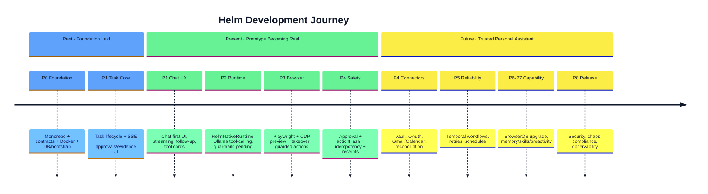
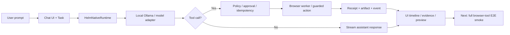
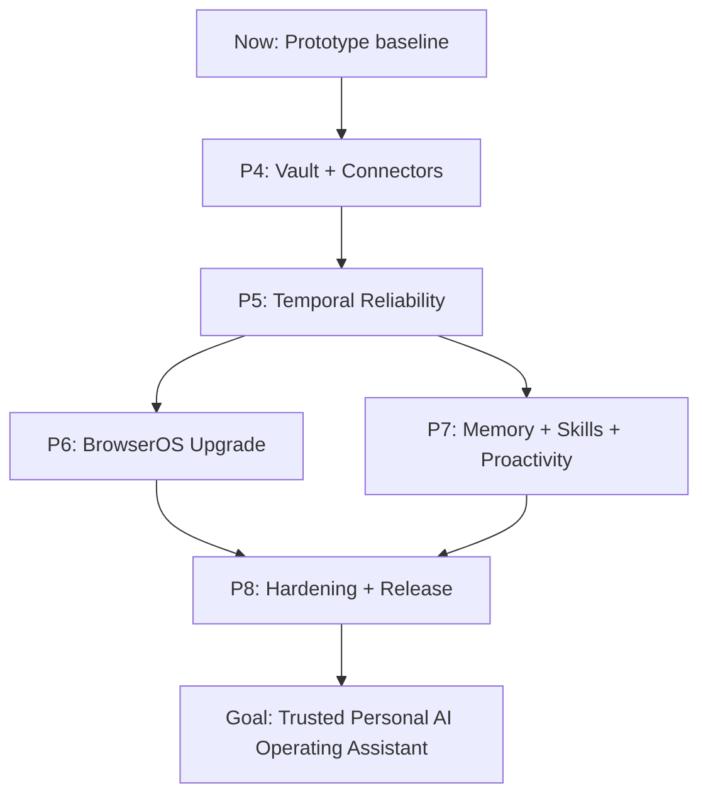

<div align="center">

# Helm Roadmap

**The journey of building a personal AI operating assistant — from blueprint to trusted execution.**

[](changes/CURRENT_STATE.md)
[](changes/CURRENT_STATE.md)
[](#-present--what-were-building-now)
[](https://github.com/Tapas15/helm/actions/runs/45561356201)

<br/>

[README](README.md) · [Current State](changes/CURRENT_STATE.md) · [Missing Items](changes/PLANNING_MISSING_ITEMS.md) · [Gap Analysis](changes/BLUEPRINT_GAP_ANALYSIS_2026-11-23.md) · [Binding Audit](changes/BINDING_AUDIT_2026-11-23.md)

</div>

---

> [!NOTE]
> Percentages are **engineering-progress estimates** from current evidence (code, tests, smokes, docs). They are **not** release, security, or compliance completion.

## Compass

| | |
|---|---|
| **Mission** | Build Helm as an original personal AI operating assistant: OpenFUSE-style control surface + Helm-native runtime + deterministic browser execution + reliability/security. |
| **Invariants** | Model proposes, policy decides · UI is not intelligence · Durable state · Idempotent external effects + receipts · No secrets in logs/events/prompts |
| **Source of truth** | [`changes/CURRENT_STATE.md`](changes/CURRENT_STATE.md) is authoritative for status; this roadmap is the visual journey. |

---

## Journey At A Glance



---

## Progress Dashboard

<table>
<tr>
<td width="50%" valign="top">

### Overall

**`73.4%`** complete (Phases 0–8, equal weight)

```text
[███████████████░░░░░] 73.4%
```

**Usable prototype with active hardening.** P6 BrowserOS parity/security, real-provider/Temporal depth, live UI smoke, and P8 ops/legal signoff remain.

</td>
<td width="50%" valign="top">

### Current Wave

**P6 BrowserOS parity + security hardening**

- Keep Playwright default; BrowserOS external MCP adapter explicit opt-in
- Expand env-gated parity evidence (artifact/error/takeover semantics)
- Harden endpoint/config validation and remote-endpoint guard
- No silent fallback/default dispatch; dispatch gate requires parity+security+CI evidence

</td>
</tr>
</table>

| Phase | Progress | Journey | Bar |
|---|---:|:---:|---|
| **P0 Foundation / Repo** | 94% | Past / stabilizing | `███████████████████░` |
| **P1 UI / Task Core** | 91% | Present / polishing | `██████████████████░░` |
| **P2 Agent Runtime** | 73% | **Present** | `███████████████░░░░░` |
| **P3 Browser Execution** | 93% | **Present** | `███████████████████░` |
| **P4 Approvals / Vault / Connectors** | 90% | **Present** | `██████████████████░░` |
| **P5 Temporal / Reliability** | 68% | **Present** | `██████████████░░░░░░` |
| **P6 BrowserOS Deterministic Upgrade** | 61% | **Present** | `████████████░░░░░░░░` |
| **P7 Memory / Skills / Proactivity** | 48% | **Present** | `██████████░░░░░░░░░░` |
| **P8 Hardening / Release** | 43% | Future / active prep | `█████████░░░░░░░░░░░` |

---

## Past — What Has Been Built

> The groundwork: contracts, durable task state, visible UI, and the first safe execution loop.

<table>
<tr>
<td width="33%" valign="top">

### 🧱 P0 — Foundation
**93%**

- pnpm/turbo/TS monorepo
- Docker Postgres/Redis
- Shared Zod contracts
- Drizzle schema + dev bootstrap
- CWD-independent Drizzle journal alignment script

</td>
<td width="33%" valign="top">

### 💬 P1 — UI / Task Core
**91%**

- Chat-first task UI
- Live SSE timeline
- Approvals / evidence / receipts
- WS browser preview + polling fallback
- Follow-up messages on same task

</td>
<td width="33%" valign="top">

### 🧾 Evidence Trail
**Active**

- `changes/CURRENT_STATE.md`
- `changes/SESSION_LOG.md`
- `changes/BLUEPRINT_GAP_ANALYSIS_2026-11-23.md`
- `changes/BINDING_AUDIT_2026-11-23.md`
- `changes/FIX_LOG.md`

</td>
</tr>
</table>

### Milestones Achieved

- [x] Repo/contracts/dev baseline established
- [x] Task create/control/SSE/event flow working
- [x] Chat-first UI with streaming and follow-up
- [x] Browser preview + takeover controls
- [x] Approval + `actionHash` + idempotency guard baseline
- [x] Session metadata/storageState restore baseline
- [x] Local Ollama simple E2E task smoke passed

---

## Present — What We're Building Now

> The current push: make Helm feel like a real personal agent, not a demo shell.



<table>
<tr>
<td width="33%" valign="top">

### 🤖 P2 — Agent Runtime
**56% · Active**

**Delivered**
- HelmNativeRuntime
- Normalized `runtime.*` events
- OpenAI-compatible streaming
- Basic tool-calling: navigate/snapshot/click
- Ollama smoke pass (`llama3.2:latest`)
- Browser-intent gating + model guardrails

**Next**
- Tool-capable model guardrails/selection
- Full browser-tool E2E with approvals
- Richer tool registry/policy
- Checkpoint/resume semantics

</td>
<td width="33%" valign="top">

### 🌐 P3 — Browser Execution
**93% · Active**

**Delivered**
- Playwright browser worker
- CDP screencast WS + API proxy
- Takeover pause/resume
- DOM/screenshot artifacts
- Guarded mutating routes
- Session metadata/storageState restore
- Stale-session restart recovery + integration coverage
- WS bearer session-token authz

**Next**
- Crash/reconnect/WS stability smoke
- Real session/OIDC UX
- Deterministic recreate contract
- Richer remote control

</td>
<td width="33%" valign="top">

### 🛡️ P4 — Approvals / Safety / Connectors
**90% · Active**

**Delivered**
- Approval resolve/requeue/cancel
- Action receipts (`approvalId + actionHash + idempotency`)
- Session-token auth scaffold + WS auth resolver
- Vault AES-GCM, OAuth PKCE scaffold
- Gmail/Calendar read+write guarded routes; real OAuth E2E verified (idempotent, no duplicate external side effect)

**Next**
- Real-provider refresh/revoke/uncertain-reconcile hardening
- Connector diagnostics/policy matrix
- Prod vault/KMS/MCP policy
- Broader binding-audit regression tests

</td>
</tr>
</table>

### Active Priorities

| Priority | Why it matters | Exit signal |
|---|---|---|
| **P6 BrowserOS parity matrix** | Proves external BrowserOS adapter can safely replace specific Playwright paths later | Env-gated parity evidence for artifact/error/takeover semantics, with no silent fallback/default dispatch |
| **P6 security/compliance review** | Keeps AGPL/external-runtime boundary and user data safe | Threat-model notes, endpoint/credential/artifact controls reviewed, dispatch gate documented |
| **P5 real-provider/Temporal depth** | Validates no-duplicate reconciliation under real conditions | Real-provider uncertain/timeout/lookup/no-duplicate proofs and Temporal operator evidence |
| **P8 hardening/release evidence** | Required for trustworthy release/submission | Backup/restore drill, scan gating, PII/threat model, compliance/provenance/Dubai signoff package |

---

## Future — What We Will Achieve

> The destination: a trusted, durable, personal AI operator with real integrations and release-grade safety.



<table>
<tr>
<td width="50%" valign="top">

### 🔌 P4+ Connectors
- Vault/credential broker
- Connector registry + manifest schema
- OAuth connect/refresh/revoke
- Gmail/Calendar behind policy
- Uncertain-outcome reconciliation

### ⏱️ P5 Temporal Reliability
- Durable workflows/signals/queries
- Class-aware retries
- Schedules/monitors
- Reconciliation workflows
- DLQ/incident runbooks

</td>
<td width="50%" valign="top">

### 🧠 P7 Memory / Skills / Proactivity
- Memory provenance/CRUD/export
- Skill registry/versioning/permissions
- Opt-in monitors and proactive suggestions
- Gated self-improvement implementation

### 🚀 P8 Hardening / Release
- Security suite: SSRF, prompt injection, redaction, authz
- Chaos/recovery and duplicate-side-effect tests
- Backup/export/retention/privacy
- Observability/SLOs/runbooks
- Submission/compliance evidence

</td>
</tr>
</table>

### Future Milestone Targets

- [x] BrowserOS MCP adapter behind contract (external runtime, no AGPL code copied)
- [x] Env-gated BrowserOS smoke 5/5 PASS (controlled local positive click/fill + adapter takeover parity)
- [ ] BrowserOS-vs-Playwright deeper artifact/error parity evidence
- [ ] BrowserOS external-runtime security/compliance/threat-model signoff
- [ ] Default dispatch gate decision (explicit, evidence-backed; no silent fallback)

---

## User-Directed Constraints

> These are explicit user instructions and must not be silently overridden by planning.

- **Local Ollama first.** No external API key required. Pick strongest local tool-capable model, add guardrails, run browser-tool E2E smoke with approvals.
- **Ask before major changes.** If planning conflicts with explicit user conversation directives, record the conflict in `changes/` and ask.
- **Self-improvement is design-only.** Hermes-like self-improvement was requested; design exists in [`changes/DESIGN-self-improvement-loop.md`](changes/DESIGN-self-improvement-loop.md), but implementation/activation requires approval and slicing.
- **Do not touch local PG17 panic service.**

---

## How To Read This Roadmap

| Document | Purpose |
|---|---|
| [`README.md`](README.md) | Project overview and quick progress snapshot |
| [`ROADMAP.md`](ROADMAP.md) | Visual journey: past, present, future |
| [`changes/CURRENT_STATE.md`](changes/CURRENT_STATE.md) | Operational source of truth (percentages, blockers, evidence) |
| [`changes/phase-6-browseros-upgrade.md`](changes/phase-6-browseros-upgrade.md) | P6 parity matrix, guardrails, and remaining gaps |
| [`changes/PLANNING_MISSING_ITEMS.md`](changes/PLANNING_MISSING_ITEMS.md) | Detailed missing checklist |
| [`changes/CONTINUATION_CHUNK.md`](changes/CONTINUATION_CHUNK.md) | Resume handoff for next session |

<div align="center">

**Helm is being built to be useful, inspectable, and safe — not just impressive.**

</div>


