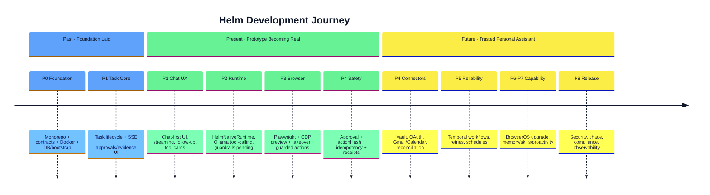
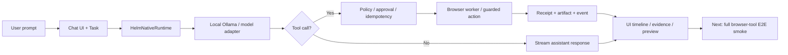
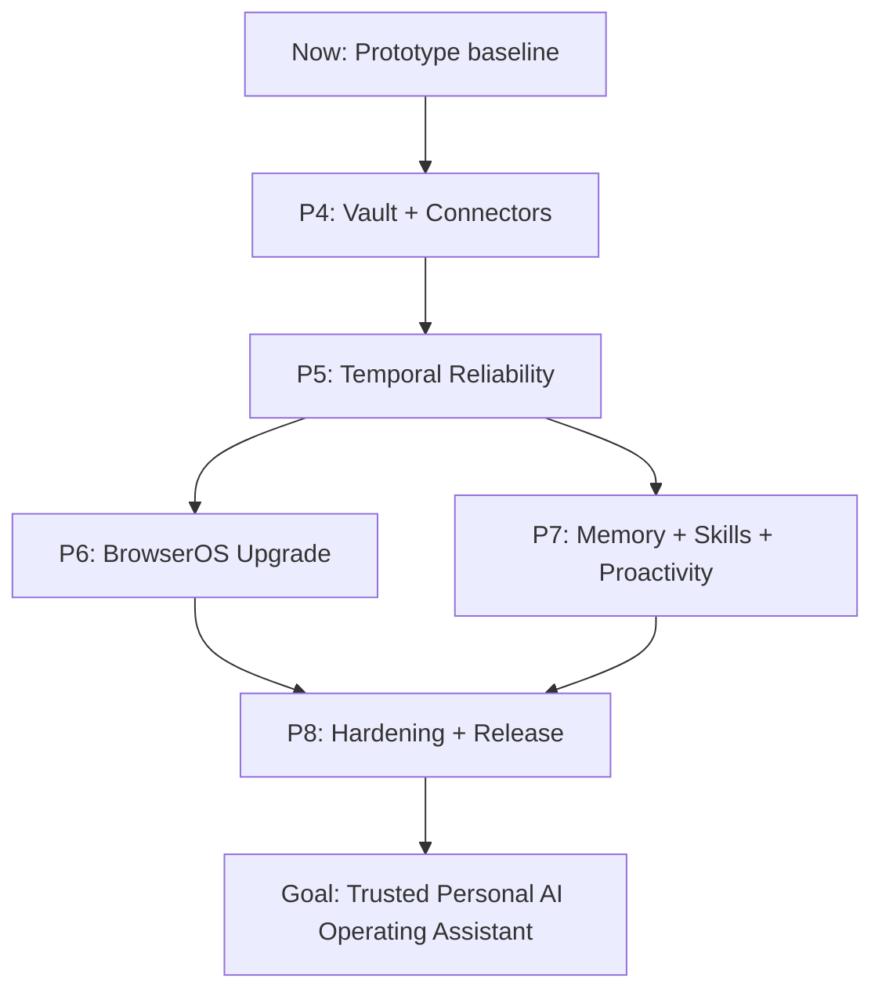

<div align="center">

# Helm Roadmap

**The journey of building a personal AI operating assistant — from blueprint to trusted execution.**

[](changes/CURRENT_STATE.md)
[](changes/CURRENT_STATE.md)
[](#-present--what-were-building-now)
[](Planning/MASTER-TECHNICAL-BLUEPRINT.md)

<br/>

[README](README.md) · [Current State](changes/CURRENT_STATE.md) · [Missing Items](changes/PLANNING_MISSING_ITEMS.md) · [Gap Analysis](changes/BLUEPRINT_GAP_ANALYSIS_2026-11-23.md) · [Binding Audit](changes/BINDING_AUDIT_2026-11-23.md)

</div>

---

> [!NOTE]
> Percentages are **engineering-progress estimates** from current evidence (code, tests, smokes, docs). They are **not** release, security, or compliance completion.

## Compass

| | |
|---|---|
| **Mission** | Build Helm as an original personal AI operating assistant: OpenFUSE-style control surface + Helm-native runtime + deterministic browser execution + reliability/security. |
| **Invariants** | Model proposes, policy decides · UI is not intelligence · Durable state · Idempotent external effects + receipts · No secrets in logs/events/prompts |
| **Source of truth** | [`changes/CURRENT_STATE.md`](changes/CURRENT_STATE.md) is authoritative for status; this roadmap is the visual journey. |

---

## Journey At A Glance



---

## Progress Dashboard

<table>
<tr>
<td width="50%" valign="top">

### Overall

**`~87%`** complete (Phases 0–8, equal weight)

```text
[█████████████████████░] 87%
```

**Prototype baseline usable.** Major reliability, security, connector, and release gaps remain.

</td>
<td width="50%" valign="top">

### Current Wave

**Local-first personal agent E2E**

- Local Ollama, no external API key required
- Pick strongest local tool-capable model
- Add model/tool guardrails
- Run browser-tool E2E smoke with approvals

</td>
</tr>
</table>

| Phase | Progress | Journey | Bar |
|---|---:|:---:|---|
| **P0 Foundation / Repo** | 91% | Past / stabilizing | `██████████████████░░` |
| **P1 UI / Task Core** | 90% | Past / polishing | `██████████████████░░` |
| **P2 Agent Runtime** | 56% | **Present** | `███████████░░░░░░░░░` |
| **P3 Browser Execution** | 93% | **Present** | `███████████████████░` |
| **P4 Approvals / Vault / Connectors** | 59% | **Present** | `████████████░░░░░░░░` |
| **P5 Temporal / Reliability** | 5% | Future | `█░░░░░░░░░░░░░░░░░░░` |
| **P6 BrowserOS Deterministic Upgrade** | 0% | Future | `░░░░░░░░░░░░░░░░░░░░` |
| **P7 Memory / Skills / Proactivity** | 0% | Future | `░░░░░░░░░░░░░░░░░░░░` |
| **P8 Hardening / Release** | 5% | Future | `█░░░░░░░░░░░░░░░░░░░` |

---

## Past — What Has Been Built

> The groundwork: contracts, durable task state, visible UI, and the first safe execution loop.

<table>
<tr>
<td width="33%" valign="top">

### 🧱 P0 — Foundation
**90%**

- pnpm/turbo/TS monorepo
- Docker Postgres/Redis
- Shared Zod contracts
- Drizzle schema + dev bootstrap
- Idempotency/CAS foundations

</td>
<td width="33%" valign="top">

### 💬 P1 — UI / Task Core
**89%**

- Chat-first task UI
- Live SSE timeline
- Approvals / evidence / receipts
- WS browser preview + polling fallback
- Follow-up messages on same task

</td>
<td width="33%" valign="top">

### 🧾 Evidence Trail
**Active**

- `changes/CURRENT_STATE.md`
- `changes/SESSION_LOG.md`
- `changes/BLUEPRINT_GAP_ANALYSIS_2026-11-23.md`
- `changes/BINDING_AUDIT_2026-11-23.md`
- `changes/FIX_LOG.md`

</td>
</tr>
</table>

### Milestones Achieved

- [x] Repo/contracts/dev baseline established
- [x] Task create/control/SSE/event flow working
- [x] Chat-first UI with streaming and follow-up
- [x] Browser preview + takeover controls
- [x] Approval + `actionHash` + idempotency guard baseline
- [x] Session metadata/storageState restore baseline
- [x] Local Ollama simple E2E task smoke passed

---

## Present — What We're Building Now

> The current push: make Helm feel like a real personal agent, not a demo shell.



<table>
<tr>
<td width="33%" valign="top">

### 🤖 P2 — Agent Runtime
**56% · Active**

**Delivered**
- HelmNativeRuntime
- Normalized `runtime.*` events
- OpenAI-compatible streaming
- Basic tool-calling: navigate/snapshot/click
- Ollama smoke pass (`llama3.2:latest`)
- Browser-intent gating + model guardrails

**Next**
- Tool-capable model guardrails/selection
- Full browser-tool E2E with approvals
- Richer tool registry/policy
- Checkpoint/resume semantics

</td>
<td width="33%" valign="top">

### 🌐 P3 — Browser Execution
**93% · Active**

**Delivered**
- Playwright browser worker
- CDP screencast WS + API proxy
- Takeover pause/resume
- DOM/screenshot artifacts
- Guarded mutating routes
- Session metadata/storageState restore
- Stale-session restart recovery + integration coverage
- WS bearer session-token authz

**Next**
- Crash/reconnect/WS stability smoke
- Real session/OIDC UX
- Deterministic recreate contract
- Richer remote control

</td>
<td width="33%" valign="top">

### 🛡️ P4 — Approvals / Safety
**59% · Active**

**Delivered**
- Approval resolve/requeue/cancel
- Action receipts
- `approvalId + actionHash + idempotency`
- Binding audit started
- Session-token auth scaffold + WS auth resolver
- Legacy unbound browser-session rebind endpoint + audit/event
- P4 vault/connector contract scaffolds

**Next**
- Real session/OIDC UX
- Encrypted vault/credential broker
- Connector registry/OAuth
- Gmail/Calendar + reconciliation

</td>
</tr>
</table>

### Active Priorities

| Priority | Why it matters | Exit signal |
|---|---|---|
| **Live UI E2E smoke (Ollama)** | Proves the personal-agent concept end-to-end | Assistant + browser task visible in chat/timeline/preview |
| **Browser-tool E2E with approvals** | Validates the core safety model | Risky browser action pauses, approves once, executes once, receipt visible |
| **Binding-audit regression tests** | Prevents side-effect bypasses | Navigate/approval/session ownership tests pass |
| **Recovery hardening** | Makes browser state trustworthy | Crash/reconnect/recreate behavior deterministic |

---

## Future — What We Will Achieve

> The destination: a trusted, durable, personal AI operator with real integrations and release-grade safety.



<table>
<tr>
<td width="50%" valign="top">

### 🔌 P4+ Connectors
- Vault/credential broker
- Connector registry + manifest schema
- OAuth connect/refresh/revoke
- Gmail/Calendar behind policy
- Uncertain-outcome reconciliation

### ⏱️ P5 Temporal Reliability
- Durable workflows/signals/queries
- Class-aware retries
- Schedules/monitors
- Reconciliation workflows
- DLQ/incident runbooks

</td>
<td width="50%" valign="top">

### 🧠 P7 Memory / Skills / Proactivity
- Memory provenance/CRUD/export
- Skill registry/versioning/permissions
- Opt-in monitors and proactive suggestions
- Gated self-improvement implementation

### 🚀 P8 Hardening / Release
- Security suite: SSRF, prompt injection, redaction, authz
- Chaos/recovery and duplicate-side-effect tests
- Backup/export/retention/privacy
- Observability/SLOs/runbooks
- Submission/compliance evidence

</td>
</tr>
</table>

### Future Milestone Targets

- [ ] Binding-audit regression tests complete
- [ ] Browser crash/reconnect deterministic contract
- [ ] Full browser-tool E2E with approvals (local Ollama)
- [ ] Vault/credential broker + connector registry
- [ ] Gmail/Calendar connectors behind policy
- [ ] Temporal durable workflows/reconciliation
- [ ] Security/chaos/release evidence pack

---

## User-Directed Constraints

> These are explicit user instructions and must not be silently overridden by planning.

- **Local Ollama first.** No external API key required. Pick strongest local tool-capable model, add guardrails, run browser-tool E2E smoke with approvals.
- **Ask before major changes.** If planning conflicts with explicit user conversation directives, record the conflict in `changes/` and ask.
- **Self-improvement is design-only.** Hermes-like self-improvement was requested; design exists in [`changes/DESIGN-self-improvement-loop.md`](changes/DESIGN-self-improvement-loop.md), but implementation/activation requires approval and slicing.
- **Do not touch local PG17 panic service.**

---

## How To Read This Roadmap

| Document | Purpose |
|---|---|
| [`README.md`](README.md) | Project overview and quick progress snapshot |
| [`ROADMAP.md`](ROADMAP.md) | Visual journey: past, present, future |
| [`changes/CURRENT_STATE.md`](changes/CURRENT_STATE.md) | Operational source of truth |
| [`changes/PLANNING_MISSING_ITEMS.md`](changes/PLANNING_MISSING_ITEMS.md) | Detailed missing checklist |
| [`changes/CONTINUATION_CHUNK.md`](changes/CONTINUATION_CHUNK.md) | Resume handoff for next session |

<div align="center">

**Helm is being built to be useful, inspectable, and safe — not just impressive.**

</div>


