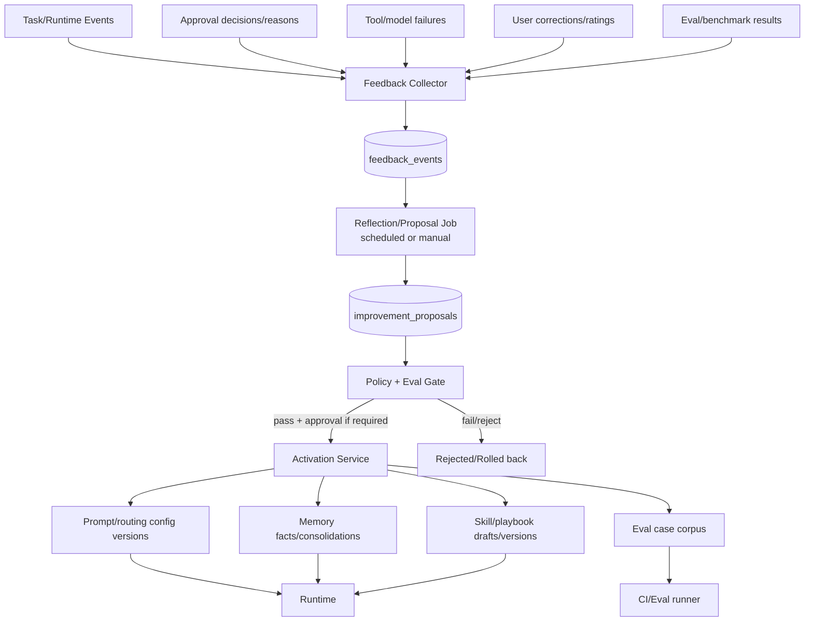

# Design: Self-Improvement Loop (Helm-owned, Hermes-inspired)

**Status:** Proposed design (not implemented)  
**Date:** 2026-11-23  
**Related:** Planning 05-Hermes-Agent-Runtime, 07-Memory/Skills (roadmap), 08-Temporal, 09-Security, 12-Testing; DEC-20261122-helm-native-hermes-like-runtime

## Goal
Add a safe, auditable self-improvement capability: Helm learns from task outcomes, approvals, failures, and evals to propose better prompts, routing, skills/playbooks, and memory facts - without self-modifying security/policy/code.

## Non-negotiable guardrails
- **Model proposes, policy decides.** No autonomous permission escalation, no policy/code self-modification.
- **Human approval for high-impact activation.** Prompt/routing/skill changes that affect external actions or security posture require approval + audit.
- **Versioned, rollbackable artifacts.** Every active improvement has version, evidence, owner, createdBy, rollback target.
- **No secrets/PII leakage.** Feedback and training artifacts pass redaction; restricted data stays local per policy.
- **Reproducible evidence.** Activation requires eval/regression evidence, not just model confidence.

## Architecture

## Data model (proposed)
- `feedback_events`: id, userId, taskId, runId, kind(`task_outcome|approval_decision|tool_failure|user_correction|model_quality|eval_result`), signal, severity, redactedPayload, evidenceRefs, createdAt.
- `improvement_proposals`: id, sourceFeedbackIds[], kind(`prompt|routing|memory|skill|playbook|eval_case`), target, diff/patchRef, rationale, risk, status(`draft|evaluated|awaiting_approval|approved|rejected|active|rolled_back`), evalReport, approvalId?, activatedAt?, rolledBackAt?.
- `memory_items`: extend existing plan with provenance(`observed|inferred|user_confirmed`), confidence, sensitivity, version, supersedesId.
- `skill_versions`: manifest, tests, permissions, sourceProposalId, status, checksum.

## Improvement classes

| Class | Auto-eligible | Gate | Notes |
|---|---|---|---|
| Eval case from failure | yes | schema + dedupe | No runtime behavior change |
| Memory fact (user confirmed) | yes | redaction + sensitivity | Inspect/edit/delete/export |
| Memory fact (inferred) | no by default | confidence + approval optional | Mark inferred; easy rollback |
| Prompt template tweak | low-risk only | eval suite pass | Versioned; A/B or canary |
| Model routing hint | no for sensitive/external | policy review + eval | Small-model tool failures feed this |
| Skill/playbook draft | no | tests + permission review + approval | Never auto-grant new scopes |
| Policy/security change | never | N/A | Human-authored only |

## Runtime integration
- Runtime emits structured outcome/quality signals after task terminal state or approval resolution.
- Reflection job runs on schedule/manual trigger; input bounded and redacted.
- Proposal activation writes versioned config rows/files; runtime reads active versions by scope (global/user/project).
- Rollback = mark proposal rolled_back and reactivate prior version; audit event required.

## Metrics / eval
- Task success rate, approval rejection rate, tool-call parse failures, retries, takeover rate, uncertain external actions.
- Proposal acceptance rate and post-activation regression delta.
- Model tool-calling reliability by model/provider.

## Phased implementation
1. **P7a Feedback + eval corpus**: capture feedback events, build failure-to-eval-case pipeline, dashboard.
2. **P7b Memory consolidation**: user-confirmed/inferred memory with provenance/sensitivity/CRUD/export.
3. **P7c Skill/playbook proposals**: draft from successful traces; test-before-enable; approval-gated activation.
4. **P7d Bounded auto-tuning**: low-risk prompt/routing A/B with rollback; high-risk always approval-gated.

## Risks
- Bad feedback poisoning -> mitigate with provenance, confidence, redaction, approval gates, rollback.
- Silent behavior drift -> mitigate with versioning, eval gates, audit, canary.
- Privacy leakage -> mitigate with sensitivity classes, local-only routing, export/delete.
